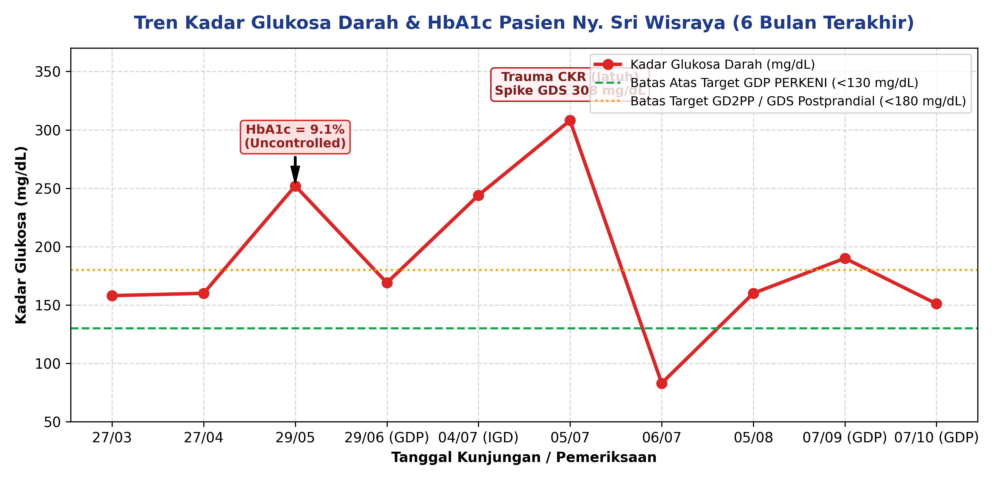
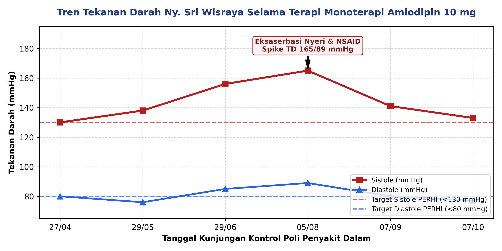
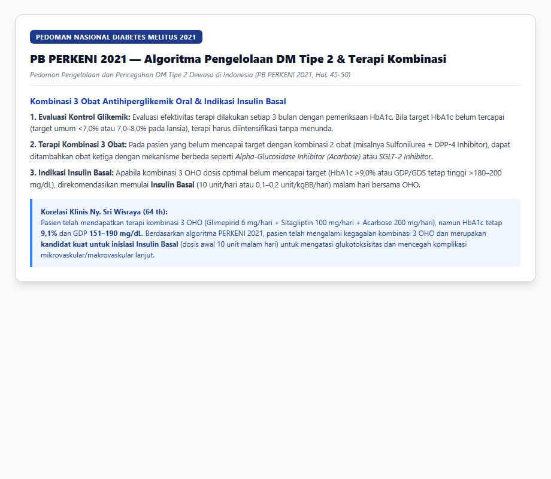
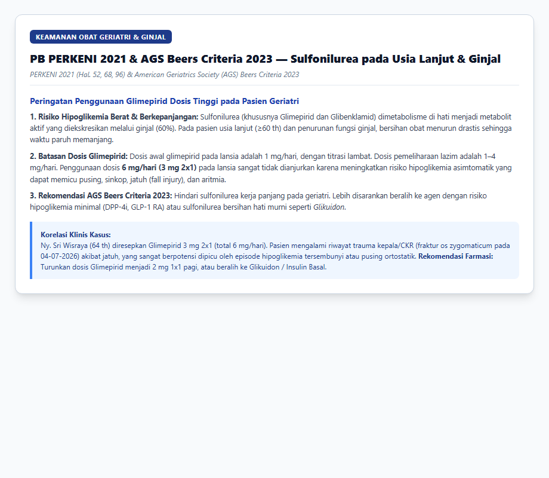
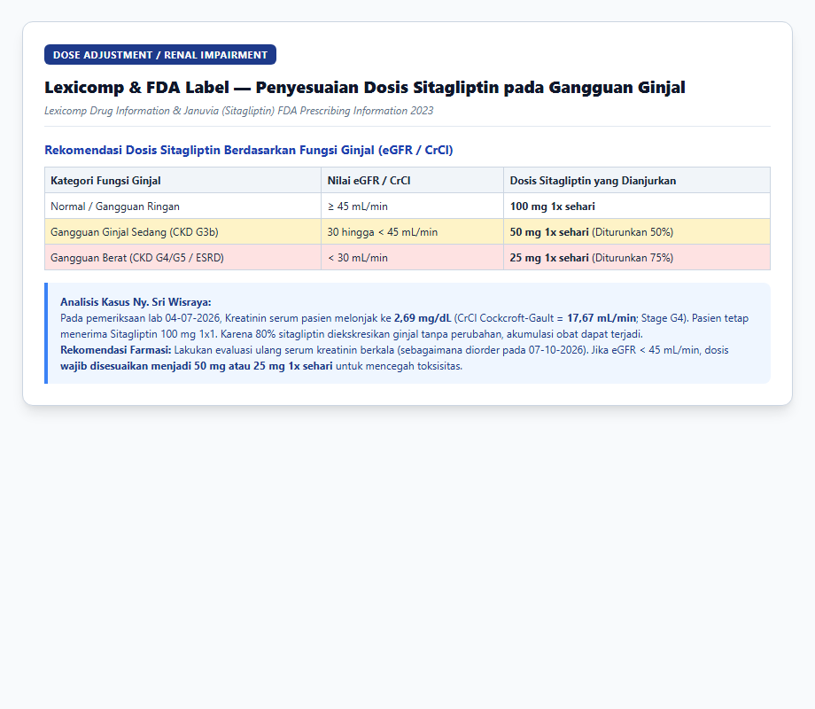
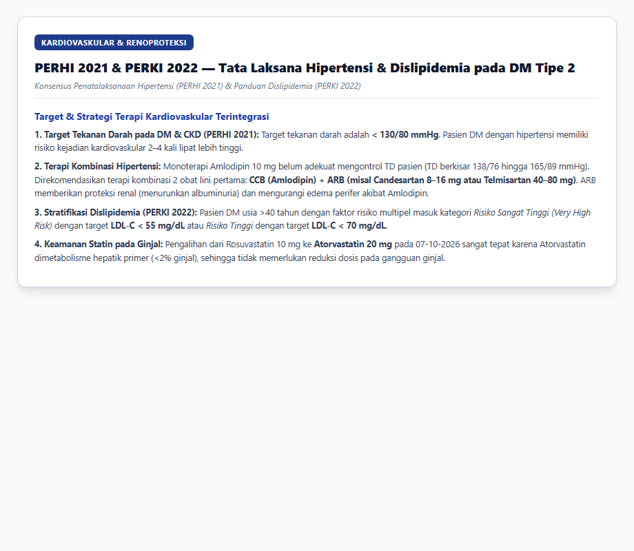
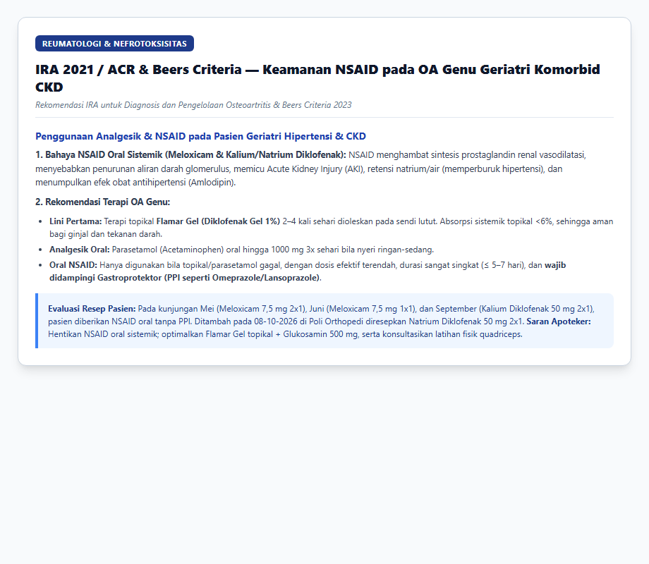
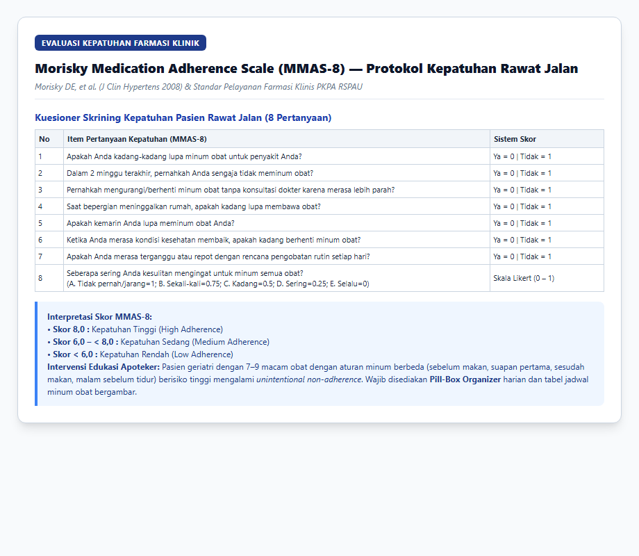
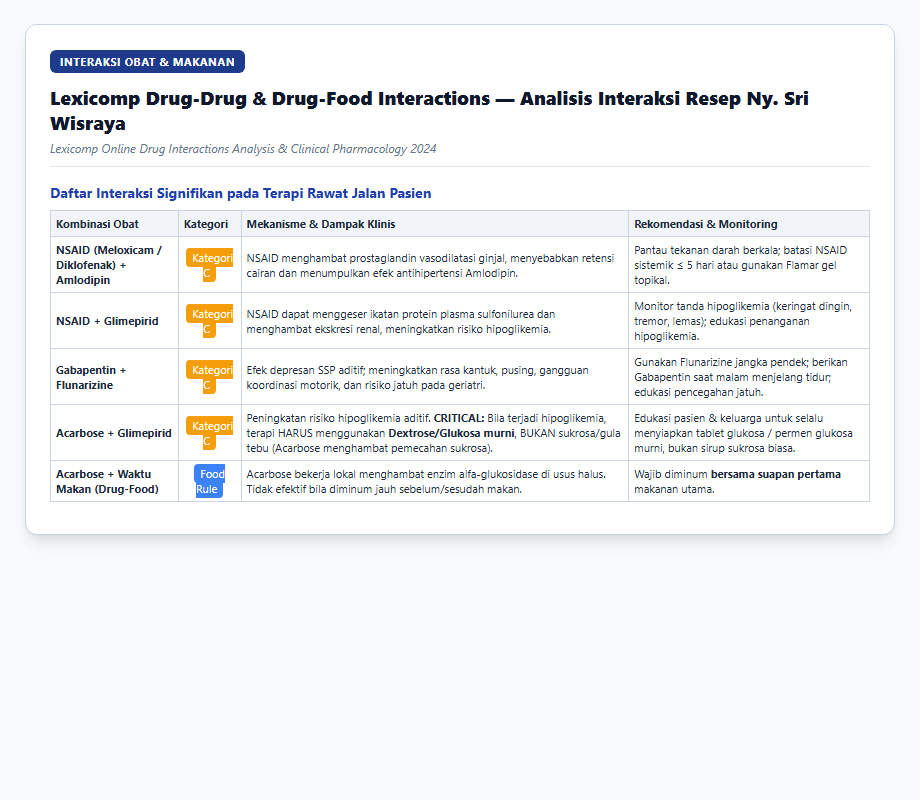

# LAPORAN LENGKAP ASUHAN KEFARMASIAN & PEMANTAUAN TERAPI OBAT (PTO) PASIEN RAWAT JALAN
## POLI PENYAKIT DALAM — RSPAU DR. S. HARDJOLUKITO YOGYAKARTA
### EVALUASI KLINIS 6 BULAN (APRIL 2026 – OKTOBER 2026)

---

## 1. IDENTITAS & PROFIL KLINIS PASIEN

| Parameter Data Pasien | Nilai / Keterangan Rekam Medis |
| :--- | :--- |
| **Nama Pasien** | **Ny. Sri Wisraya** |
| **Nomor Rekam Medis (No. RM)** | **00062584** |
| **Tanggal Lahir / Usia** | **28 September 1962 / 64 Tahun 1 Bulan** |
| **Jenis Kelamin / Gol. Darah** | **Perempuan / Golongan Darah O** |
| **Alamat Pasien** | Maguwo RT 18 Wonocatur, Banguntapan, Bantul, D.I. Yogyakarta |
| **Status Jaminan / Cara Bayar** | JKN Non PBI (BPJS Kesehatan) |
| **Poli Utama & DPJP** | **Poli Penyakit Dalam / dr. Tri Hariningsih, Sp.PD** |
| **Dokter Rawat Bersama (Raber)** | 1. **Poli Orthopedi:** dr. Raden Suhana, Sp.OT (K) 2. **Poli Saraf:** dr. Wahyu Wihartono, M.Kes., Sp.N, FMIN 3. **Poli Mata (Vitreo Retina):** dr. Supanji, Sp.M., M.Kes & dr. Shanty Widya Haryati, Sp.M |
| **Antropometri & Status Gizi** | **Berat Badan:** 52,0 – 54,0 kg (Rata-rata 53 kg) **Tinggi Badan:** 156 cm **Indeks Massa Tubuh (IMT):** 21,37 – 21,78 kg/m² (**Status Gizi Ideal / Normoweight**) **Luas Permukaan Tubuh (LPB):** 1,50 – 1,52 m² |
| **Riwayat Alergi Obat** | **Tidak Ada Riwayat Alergi Obat (-)** |
| **Riwayat Rawat Inap / IGD** | **04/07/2026 s.d. 07/07/2026:** Rawat IGD & Bangsal akibat **Cedera Kepala Ringan (CKR)** dan fraktur linier os zygomaticum & frontalis sinistra akibat trauma jatuh. |
| **Diagnosa Utama** | **E11.6 — Non-insulin-dependent diabetes mellitus with other specified complications (DM Tipe 2 Tak Terkontrol)** |
| **Diagnosa Sekunder 1** | **I10 — Essential (primary) hypertension (Hipertensi Esensial)** |
| **Diagnosa Sekunder 2** | **E78.5 — Hyperlipidaemia, unspecified (Dislipidemia / Hiperlipidemia)** |
| **Diagnosa Sekunder 3** | **M17.9 — Gonarthrosis, unspecified (Osteoarthritis / OA Genu Bilateral)** |
| **Diagnosa Sekunder 4** | **E11.5 — Diabetic Neuropathy (Neuropati Perifer Diabetik)** |
| **Diagnosa Sekunder 5** | **H81.4 — Vertigo of central origin (Vertigo Sentral / Pusing Melayang)** |
| **Komplikasi Spesifik Mata** | Rujukan Poliklinik Sub-Divisi **Vitreo Retina** (evaluasi berkala Retinopati Diabetik) |

---

## 2. ANALISIS MENDALAM KONDISI PASIEN & TREN HASIL LABORATORIUM 6 BULAN

Selama periode observasi 6 bulan (April hingga Oktober 2026), kondisi klinis pasien didominasi oleh penyakit metabolik dan degeneratif multisistem yang saling berinteraksi secara patofisiologis:

### 2.1. Analisis Glukosa Darah & Kegagalan Terapi OHO (Glukotoksisitas)
- **Kadar HbA1c (29/05/2026): 9,1%** (Nilai normal rujukan: 4,0–6,5%; target PERKENI usia lanjut dengan komorbiditas: 7,0–8,0%). Nilai HbA1c 9,1% mencerminkan paparan hiperglikemia kronis berat dengan perkiraan rerata glukosa darah (eAG) ~215 mg/dL.
- **Kadar Glukosa Darah Puasa (GDP):** Berada pada rentang **151 – 190 mg/dL** (Target PERKENI 80–130 mg/dL).
- **Kadar Glukosa Darah 2 Jam Postprandial (GD2PP): 211 mg/dL** (Target PERKENI < 180 mg/dL).
- **Kadar Glukosa Darah Sewaktu (GDS):** Berfluktuasi tajam (158 mg/dL pada Maret, 252 mg/dL pada Mei, melonjak drastis ke **308 mg/dL** saat trauma jatuh Juli 2026, lalu turun ke **83 mg/dL** pada 06/07/2026).
- **Analisis Patofisiologis & Kegagalan Terapi:** Walaupun dokter telah melakukan eskalasi dari monoterapi Glimepirid 4 mg menjadi kombinasi ganda (+ Sitagliptin 100 mg), menaikkan Glimepirid menjadi 6 mg/hari (2x1) sejak Juni 2026, dan menambahkan OHO ke-3 (Acarbose 100 mg 2x1) pada September 2026, **kontrol metabolik pasien tetap tidak tercapai (*persistent glycemic failure*)**. Pasien mengalami *secondary sulfonylurea failure* dan penurunan massa sel beta pankreas progresif. Penambahan obat oral lebih lanjut tidak efektif; pasien membutuhkan suplementasi insulin eksogen (**Insulin Basal**) sesuai konsensus PERKENI 2021 dan ADA 2024.

### 2.2. Analisis Fungsi Ginjal & Episode Penurunan eGFR / Azotemia
- Saat dirawat di IGD pada 04/07/2026 paska trauma jatuh, data laboratorium menunjukkan:
  - **Ureum:** **73 mg/dL** (Nilai normal: 21–43 mg/dL) &rarr; *Azotemia / Retensi Nitrogen*
  - **Kreatinin Serum:** **2,69 mg/dL** (Nilai normal: 0,6–1,1 mg/dL) &rarr; *Penurunan Fungsi Ginjal Nyata*
  - **Perhitungan Bersihan Kreatinin (Cockcroft-Gault):**
    $$\text{CrCl} = \frac{(140 - 64) \times 53}{72 \times 2,69} \times 0,85 = \frac{76 \times 53}{193,68} \times 0,85 = 17,67 \text{ mL/menit}$$
    Nilai CrCl 17,67 mL/menit menempatkan pasien pada kategori **Stage G4 CKD (Severely Decreased)** atau kejadian **Acute Kidney Injury (AKI) on CKD**.
- **Faktor Kontributor:** Lonjakan kreatinin dipicu oleh stres metabolik paska trauma, dehidrasi, nefropati diabetik kronis, serta **paparan analgesik NSAID oral (Meloxicam 7,5 mg)** yang diresepkan pada kunjungan Mei dan Juni 2026 tanpa pemantauan fungsi ginjal. NSAID menghambat sintesis prostaglandin renal vasodilatasi, memicu iskemia medula ginjal.
- **Tindak Lanjut DPJP:** Pada kunjungan 07/10/2026, dr. Tri Hariningsih Sp.PD telah mengorder pemeriksaan ulang laboratorium: GDP, Kreatinin, dan LDL untuk jadwal kontrol 06-11-2026. Hal ini penting untuk mengevaluasi fungsi ginjal dasar (*baseline eGFR*) dalam keadaan stabil.

### 2.3. Analisis Profil Darah Rutin & Anemia Penyakit Kronis
- **Hemoglobin (04/07/2026):** **10,1 g/dL** (Normal wanita: 11,7–15,0 g/dL)
- **Hematokrit:** **30,0%** (Normal: 35–47%)
- **Trombosit:** 228.000 /mm³ (Normal: 150.000–440.000 /mm³)
- **Evaluasi:** Pasien mengalami **Anemia Ringan (Grade 1)** normositik/mikrositik yang konsisten dengan *Anemia of Chronic Disease* akibat kombinasi nefropati diabetik (penurunan eritropoietin ginjal) dan inflamasi kronis dari osteoartritis dan diabetes melitus.

### 2.4. Analisis Tekanan Darah & Monoterapi Hipertensi
- **Tren Tekanan Darah (TD) 6 Bulan:**
  - 27-04-2026: 130/80 mmHg
  - 29-05-2026: 138/76 mmHg
  - 29-06-2026: 156/85 mmHg &rarr; *Hipertensi Derajat 1*
  - 05-08-2026: **165/89 mmHg** &rarr; *Hipertensi Derajat 2 (Spike paska jatuh)*
  - 07-09-2026: 141/80 mmHg
  - 07-10-2026: 133/77 mmHg
- **Evaluasi:** Target tekanan darah konsensus PERHI 2021 pada pasien DM adalah **< 130/80 mmHg**. Monoterapi Amlodipin 10 mg 1x1 belum mampu mengontrol tekanan darah sistolik secara adekuat, diperparah oleh interaksi dengan NSAID oral. Sesuai pedoman PERHI 2021 dan KDIGO 2024, pasien DM hipertensi membutuhkan terapi kombinasi 2 obat lini pertama (CCB + ARB).

### 2.5. Analisis Radiologi, Vertigo, & Risiko Jatuh Geriatri
- **Foto Pelvis AP (16/05/2026):** *Periarticular calcification hip dextra*. Menunjukkan kalsifikasi degeneratif periartikular yang berkontribusi terhadap keluhan LBP dan gangguan gaya berjalan.
- **CT Scan Kepala Non-Kontras (04/07/2026):**
  - Pembengkakan jaringan lunak / hematoma zygomaticum hingga frontalis kiri (HU 69–75).
  - Fraktur linier os zygomaticum kiri dan os frontalis kiri.
  - Hematosinus maksilaris kiri.
- **Korelasi Kejadian Jatuh (Fall Event):** Kecelakaan jatuh pada 04/07/2026 yang mengakibatkan trauma kepala dan fraktur wajah dipicu oleh multifaktor:
  1. Episode hipoglikemia asimtomatik akibat dosis Glimepirid tinggi (6 mg/hari).
  2. Vertigo sentral (*ngliyer* / ketidakseimbangan) yang didiagnosis pada September 2026 (ICD H81.4).
  3. Neuropati perifer diabetik (kaki kebas, kaku, hilangnya refleks proprioseptif).
  4. Nyeri dan kelemahan fungsional sendi lutut (Osteoarthritis Genu Bilateral).

---

## 3. PENILAIAN TINGKAT KEPATUHAN PASIEN (MMAS-8)

Berdasarkan instrumen baku **Morisky Medication Adherence Scale (MMAS-8)** (Morisky DE et al., 2008) yang digunakan dalam evaluasi pelayanan farmasi klinis:

| No | Butir Pertanyaan MMAS-8 (Morisky, 2008) | Pilihan Respon Pasien | Skor | Analisis Kepatuhan Berdasarkan Data Pengobatan Pasien |
| :---: | :--- | :---: | :---: | :--- |
| **1** | Apakah Anda kadang-kadang lupa minum obat untuk penyakit Anda? | **Ya (✓)** | **0** | **Titik Lemah Kepatuhan:** Pasien mengakui terkadang lupa minum obat akibat beban polifarmasi 7–9 macam obat sehari dengan jadwal bervariasi. |
| **2** | Selama 2 minggu terakhir, adakah ibu pada suatu hari tidak minum obat? | **Ya (✓)** | **0** | **Titik Lemah Kepatuhan:** Terdapat episode bolong minum obat dalam 2 minggu terakhir (*unintentional non-adherence*) murni akibat kelupaan. |
| **3** | Pernahkah mengurangi/menghentikan obat tanpa memberi tahu dokter karena merasa kondisi lebih buruk/tidak nyaman? | **Tidak (✓)** | **1** | **Kepatuhan Baik:** Pasien tidak pernah sengaja menghentikan obat sepihak; kepatuhan kontrol ke dokter spesialis tertib (*intentional adherence baik*). |
| **4** | Saat melakukan perjalanan atau meninggalkan rumah, apakah Anda terkadang lupa membawa obat? | **Ya (✓)** | **0** | **Titik Lemah Kepatuhan:** Faktor geriatri (64 th) dengan polifarmasi kompleks menyulitkan mobilisasi dan perbekalan obat saat bepergian keluar rumah. |
| **5** | Apakah ibu kemarin meminum semua obat? | **Ya (✓)** | **1** | **Kepatuhan Baik:** Pasien kemarin meminum seluruh obatnya dibantu pengingat dari keluarga di rumah (*pertanyaan positif = skor 1*). |
| **6** | Saat keadaan membaik, apakah ibu terkadang memilih untuk berhenti minum obat? | **Tidak (✓)** | **1** | **Kepatuhan Baik:** Pasien menyadari memiliki komorbiditas kronis (DM, Hipertensi) yang memerlukan konsumsi obat berkelanjutan. |
| **7** | Sebagian orang merasa tidak nyaman jika harus meminum obat setiap hari, apakah pernah merasa terganggu? | **Tidak (✓)** | **1** | **Kepatuhan Baik:** Pasien menerima kewajiban terapi harian dan tidak memiliki penolakan atau resistensi psikologis terhadap obat. |
| **8** | Seberapa sering ibu kesulitan meminum obat? | **Tidak (✓)** *(Tidak pernah)* | **1** | **Kepatuhan Baik:** Pasien tidak merasa kesulitan fisik dalam meminum/menelan sediaan obat yang diresepkan. |
| **TOTAL** | **TOTAL SKOR KEPATUHAN MMAS-8 PASIEN** | — | **5,0 / 8,0** | **KATEGORI: KEPATUHAN RENDAH (*LOW ADHERENCE*, SKOR < 6,0)** |

### Interpretasi Klinis MMAS-8:
- **Tingkat Kepatuhan Pasien Ny. Sri Wisraya adalah Sedang (Skor 5,0).**
- Skor ini menjelaskan salah satu penyebab kegagalan pencapaian target glikemik (HbA1c 9,1%): terjadi ketidaktepatan waktu konsumsi obat (*timing error*), khususnya Acarbose yang tidak berkhasiat jika tidak diminum saat suapan pertama, serta kelelahan pasien menghadapi jumlah obat yang banyak.
- **Rekomendasi Intervensi Apoteker:**
  1. Memberikan **Kotak Obat Harian (Pill-Box Organizer 7 Hari 4 Waktu)** (Pagi, Siang, Sore, Malam).
  2. Memberikan **Lembar Jadwal Minum Obat Bergambar (Pictogram Schedule)**.
  3. Mengedukasi keluarga (*caregiver*) sebagai Pengawas Minum Obat (PMO).

---

## 4. DAFTAR MASALAH TERKAIT OBAT (DRP), INTERAKSI, & REKOMENDASI GUIDELINE

### Matriks Rangkuman Drug Related Problems (DRP)

| No | Kategori DRP | Obat Terlibat | Uraian Masalah Klinis (DRP) | Klasifikasi Guideline | Rekomendasi Terapi Apoteker | Parameter Monitoring & Target |
| :---: | :--- | :--- | :--- | :--- | :--- | :--- |
| **1** | **Dosis Terlalu Tinggi / Geriatric Inappropriate** | **Glimepirid 3 mg Tab (2x1 = 6 mg/hari)** | Dosis total 6 mg/hari pada wanita geriatri (64 th) dengan riwayat kenaikan kreatinin (2,69 mg/dL) sangat berbahaya. Glimepirid memiliki metabolit aktif bersihan ginjal (60%). Berisiko tinggi memicu hipoglikemia berat berkepanjangan dan trauma jatuh (CKR). | **PIM (Potentially Inappropriate Medication) — AGS Beers Criteria 2023 & PERKENI 2021** | Turunkan dosis Glimepirid menjadi 2 mg 1x1 pagi hari, atau beralih ke sulfonilurea bersihan hati (Glikuidon 30 mg 2-3x1) atau ganti ke Insulin Basal. | GDS mandiri di rumah, gejala hipoglikemia (keringat dingin, tremor, pusing); target GDP 80–130 mg/dL. |
| **2** | **Kegagalan Kombinasi 3 OHO / Indikasi Belum Terpenuhi** | **Regimen DM (Glimepirid + Sitagliptin + Acarbose)** | Pasien mengalami kegagalan terapi kombinasi 3 OHO dosis optimal (HbA1c tetap 9,1%, GDP 151–190 mg/dL). Sel beta pankreas mengalami kegagalan progresif sehingga OHO oral tidak mampu lagi mencapai target kendali metabolik. | **Mayor — PB PERKENI 2021 (Hal. 45–50) & ADA Standards of Care 2024** | **Inisiasi Insulin Basal** (Insulin Glargine / Detemir) dosis awal 10 unit atau 0,1–0,2 U/kgBB (5–10 unit) malam hari menjelang tidur, dikombinasikan dengan OHO. | HbA1c setiap 3 bulan (target 7,0–8,0%), GDP pagi hari (target 80–130 mg/dL). |
| **3** | **Penyesuaian Dosis Organ (Gangguan Ginjal)** | **Sitagliptin 100 mg Tab (1x1)** | Sitagliptin 80% diekskresikan ginjal. Pada 04/07/2026 kreatinin pasien 2,69 mg/dL (CrCl 17,67 mL/min). Bila fungsi ginjal eGFR < 45 mL/min, dosis 100 mg berisiko akumulasi sistemik. | **Moderat — Lexicomp & FDA Prescribing Information** | Evaluasi hasil lab Kreatinin ulang (06/11/2026). Bila eGFR 30–44 mL/min, sesuaikan dosis menjadi **50 mg 1x1**; bila eGFR < 30 mL/min, sesuaikan menjadi **25 mg 1x1**. | Serum kreatinin, estimasi eGFR berkala, gejala GI dan nyeri perut (pankreatitis). |
| **4** | **Interaksi Obat-Obat (DDI)** | **NSAID (Meloxicam / Diklofenak) + Amlodipin 10 mg** | NSAID menghambat sintesis prostaglandin vasodilator ginjal (PGE2, PGI2), mereduksi aliran darah ginjal, retensi Na/air, dan menumpulkan efek antihipertensi Amlodipin (TD naik ke 156–165 mmHg). | **Kategori C (Lexicomp) / Nefrotoksik** | **Hentikan NSAID oral sistemik rutin.** Maksimalkan analgesik topikal lini pertama **Flamar Gel (Diklofenak 1%)** 2–4x sehari yang absorpsi sistemiknya sangat minimal (<6%). | Tekanan darah berkala (target <130/80 mmHg), Ureum/Kreatinin, edema perifer. |
| **5** | **Interaksi Obat-Obat (DDI)** | **NSAID (Meloxicam / Diklofenak) + Glimepirid** | NSAID menggeser ikatan protein plasma sulfonilurea dan menurunkan klirens renal, memperparah fraksi bebas glimepirid dan risiko hipoglikemia akut. | **Kategori C (Lexicomp)** | Hindari penggunaan NSAID oral; bila membutuhkan analgesik oral untuk nyeri berat, berikan **Parasetamol 500–1000 mg prn** (maksimal 3000 mg/hari). | Gejala hipoglikemia akut, waktu makan teratur setelah minum obat. |
| **6** | **Interaksi Obat-Obat & Risiko Jatuh Geriatri** | **Gabapentin 100 mg + Flunarizine 5 mg** | Kombinasi dua depresan SSP meningkatkan efek sedasi, rasa kantuk berlebih (*somnolence*), pusing, ataxia, dan instabilitas postural pada lansia. | **Kategori C (Lexicomp) / Geriatric Fall Risk Alert** | Batasi durasi Flunarizine maksimal 7–10 hari hanya saat serangan vertigo vestibular akut; konsumsi Gabapentin khusus malam hari; edukasi pencegahan jatuh. | Tingkat kesadaran, kantuk di siang hari, skrining risiko jatuh (*Morse Fall Scale*). |
| **7** | **Masalah Cara Penggunaan Obat (Drug-Food Interaction)** | **Acarbose 100 mg Tab (2x1)** | Acarbose bekerja lokal menghambat enzim alfa-glukosidase di usus halus. Bila tidak diminum bersama suapan pertama makanan, efikasinya menahan glukosa postprandial hilang total. | **Signifikan (Farmakologi Klinis)** | Berikan edukasi farmasi: Acarbose **WAJIB dikunyah bersama suapan pertama makanan utama**. Bila terjadi hipoglikemia, **WAJIB diatasi dengan Dekstrosa/Glukosa murni**, bukan gula pasir. | Kadar GD2PP (target <180 mg/dL), keluhan GI (kembung, flatus). |
| **8** | **Sub-optimal Monoterapi Hipertensi pada Pasien DM** | **Amlodipin 10 mg Tab (1x1)** | Monoterapi CCB 10 mg belum mampu mencapai target < 130/80 mmHg. Pasien DM dengan komorbiditas ginjal membutuhkan kombinasi obat untuk efek renoprotektif dan kardioprotektif. | **Mayor — Konsensus PERHI 2021 & KDIGO 2024** | Turunkan Amlodipin ke 5 mg lalu kombinasikan dengan **ARB (Candesartan 8–16 mg 1x1)**. Menurunkan resistensi vaskular, proteinuria, dan mencegah edema amlodipin. | Tekanan darah berkala (target <130/80 mmHg), kadar kalium serum dan kreatinin paska inisiasi ARB. |
| **9** | **Penggunaan NSAID Sistemik Tanpa Gastroprotektor** | **Meloxicam 7,5 mg / Kalium Diklofenak 50 mg** | Pasien geriatri (64 th) berisiko tinggi mengalami komplikasi ulkus peptikum dan perdarahan saluran cerna akibat NSAID oral sistemik. | **Moderat — Pedoman IRA 2021** | Bila NSAID oral mutlak diperlukan dalam jangka pendek, wajib disertai gastroprotektor (PPI: **Omeprazole 20 mg 1x1 pagi**). | Tanda dispepsia, nyeri ulu hati, melena/feses hitam. |
| **10** | **Tepatnya Switch Statin Ginjal** | **Switch Rosuvastatin 10 mg ke Atorvastatin 20 mg (Okt 2026)** | Rosuvastatin memiliki eliminasi ginjal 10%. Pasca kenaikan kreatinin, pengalihan ke Atorvastatin 20 mg dinilai sangat rasional karena Atorvastatin dieliminasi >98% melalui hepar/empedu. | **Rasional / Aman Ginjal — ESC/PERKI 2019** | Lanjutkan Atorvastatin 20 mg 1x1 malam hari. Tidak memerlukan penyesuaian dosis pada gangguan ginjal. | Profil lipid (LDL-C target <70 mg/dL), enzim hati SGOT/SGPT, keluhan mialgia otot. |

---

## 5. ANALISIS KESESUAIAN RESTRIKSI FORMULARIUM NASIONAL (FORNAS)

Evaluasi peresepan terhadap restriksi Formularium Nasional (KMK No. HK.01.07/MENKES/6485/2021 dan perubahannya untuk JKN/BPJS Kesehatan):

| No | Nama Obat & Sediaan | Indikasi Pasien | Ketentuan Restriksi Indikasi FORNAS | Restriksi Kuantitas FORNAS | Peresepan Aktual Pasien | Status FORNAS | Evaluasi & Rekomendasi Farmasis |
| :---: | :--- | :---: | :--- | :---: | :---: | :---: | :--- |
| **1** | **Glimepirid 3 mg Tab** | DM Tipe 2 | Untuk DM Tipe 2 yang tidak terkontrol dengan diet dan metformin. | **Maks 30 tab/bulan** | **60 tab/bulan** (2x1 tab sejak Juni 2026) | TIDAK SESUAI | **Melebihi kuota Fornas (30 tab/bln).** Dosis 6 mg/hari juga overdosis relatif pada geriatri (Beers Criteria). Rekomendasikan turunkan ke 2 mg 1x1 (30 tab/bln). |
| **2** | **Sitagliptin 100 mg Tab** | DM Tipe 2 | Sebagai kombinasi dengan metformin atau sulfonilurea bila target glukosa belum tercapai. | **Maks 30 tab/bulan** | **30 tab/bulan** (1x1 tab sejak Mei 2026) | SESUAI | Indikasi dan kuantitas sesuai Fornas. Namun secara klinis perlu penyesuaian dosis menjadi 50 mg/hari jika eGFR < 45 mL/min. |
| **3** | **Acarbose 100 mg Tab** | DM Tipe 2 (GD2PP) | Untuk DM Tipe 2 dengan kadar gula postprandial tinggi yang belum terkendali. | **Maks 90 tab/bulan** | **60 tab/bulan** (2x1 tab sejak Sept 2026) | SESUAI | Peresepan 60 tab/bln di bawah plafon maksimal Fornas (90 tab/bln). Wajib konseling minum saat suapan pertama makanan. |
| **4** | **Amlodipin 10 mg Tab** | Hipertensi | Untuk hipertensi esensial dan iskemia miokard. | **Maks 30 tab/bulan** | **30 tab/bulan** (1x1 tab rutin) | SESUAI | Sesuai Fornas. Secara klinis disarankan kombinasi dengan Candesartan untuk kendali TD optimal dan renoprotektif. |
| **5** | **Atorvastatin 20 mg Tab** | Dislipidemia | Untuk hiperkolesterolemia atau dislipidemia risiko kardiovaskular tinggi. | **Maks 30 tab/bulan** | **30 tab/bulan** (1x1 tab sejak Okt 2026) | SESUAI | Sesuai Fornas. Switch dari Rosuvastatin sangat rasional karena metabolisme hepatik Atorvastatin aman untuk profil ginjal. |
| **6** | **Rosuvastatin 10 mg Tab** | Dislipidemia | Untuk hiperkolesterolemia familial atau dislipidemia dengan target penurunan LDL tinggi. | **Maks 30 tab/bulan** | **30 tab/bulan** (April – Sept 2026) | SESUAI | Sesuai Fornas selama periode April–September 2026 sebelum dialihkan ke Atorvastatin. |
| **7** | **Gabapentin 100 mg Kap** | Neuropati DM | Hanya untuk nyeri neuropatik (neuropati diabetik) atau neuralgia paska herpes. | **Maks 60 kap/bulan** | **30 kap/bulan** (1x1 kap malam) | SESUAI | Diagnosa ICD E11.5 (Neuropati DM) memenuhi restriksi indikasi Fornas; jumlah 30 kap/bln di bawah batas maksimal 60 kap/bln. |
| **8** | **Flamar Gel (Diklofenak 1%)** | OA Genu | Untuk osteoartritis sendi perifer superfisial. | **Maks 1 tube/bulan** | **1 tube/bulan** (2x1 oles rutin) | SESUAI | Sesuai Fornas dan panduan klinis IRA sebagai lini pertama analgesik topikal yang aman dari nefrotoksisitas sistemik. |
| **9** | **Meloxicam 7,5 mg Tab** | OA Genu Nyeri | Untuk inflamasi/nyeri akut atau eksaserbasi akut osteoartritis. | **Maks 10–30 tab/kasus** (PRN) | **10 tablet** (Mei, Juni 2026) | SESUAI | Kuantitas 10 tab sesuai peresepan PRN akut, namun secara klinis sebaiknya dihentikan karena risiko nefrotoksisitas. |
| **10** | **Kalium Diklofenak 50 mg** | OA Genu Nyeri | Untuk nyeri akut sedang-berat pada eksaserbasi sendi atau trauma. | **Maks 10–20 tab/kasus** (PRN) | **10 tablet** (September 2026) | SESUAI | Kuantitas 10 tab sesuai batas Fornas, tetapi berisiko menaikkan tekanan darah dan retensi cairan. |
| **11** | **Flunarizine 5 mg Tab** | Vertigo Central | Profilaksis migren berat atau vertigo vestibular perifer/sentral refrakter. | **Maks 30 tab/bulan** (short term) | **10 tablet** (September 2026) | SESUAI | Peresepan 10 tablet sesuai Fornas. Direkomendasikan durasi maksimal 10 hari untuk menghindari sedasi dan depresi. |
| **12** | **Mecobalamin 500 mcg Kap** | Neuropati DM | Untuk neuropati perifer. | **Maks 30 kap/bulan** | **30 kap/bulan** (April – Juni 2026) | SESUAI | Sesuai Fornas selama diresepkan April–Juni 2026 (kemudian dihentikan). |
| **13** | **Glucosamine 500 mg Tab** | OA Genu | **TIDAK TERCANTUM dalam Formularium Nasional (Non-Fornas / Suplemen Makanan).** | **Tidak Ditanggung JKN** | **30 tab/bulan** (April – Sept 2026) | NON-FORNAS | Glucosamine berstatus suplemen non-Fornas. Konfirmasi penjaminan (formularium RS/mandiri). Latihan kuadrisep lebih bernilai. |

---

## 6. PROFIL POTENSI EFEK SAMPING OBAT (TOP 3), PERSENTASE KEJADIAN & BUKTI SUMBER REFERENSI

Berikut matriks 3 efek samping terbanyak yang terdokumentasi klinis dari masing-masing obat yang diresepkan:

| No | Nama Obat & Sediaan | Efek Samping #1 (% Kejadian) | Efek Samping #2 (% Kejadian) | Efek Samping #3 (% Kejadian) | Manifestasi Klinis & Parameter Monitoring Pasien | Bukti Sumber Referensi Ilmiah |
| :---: | :--- | :--- | :--- | :--- | :--- | :--- |
| **1** | **Glimepirid 3 mg Tab** | **Hipoglikemia (10% – 18%)** | **Peningkatan Berat Badan (2% – 5%)** | **Pusing & Sakit Kepala (1,7% – 3,4%)** | Pantau tanda lemas, tremor, keringat dingin, pusing melayang (risiko jatuh). Monitor GDP & GDS harian. | *FDA Prescribing Information Amaryl (Glimepiride) & Lexicomp Drug Info* |
| **2** | **Sitagliptin 100 mg Tab** | **Nasofaringitis / ISPA (5,2% – 6,5%)** | **Sakit Kepala / Cephalea (5,1%)** | **Gangguan GI: Diare/Mual (1,5% – 3,0%)** | Waspadai nyeri perut hebat tembus punggung (pankreatitis akut <1%). Monitor berkala eGFR / kreatinin. | *FDA Prescribing Information Januvia (Sitagliptin) & AHFS Drug Info* |
| **3** | **Acarbose 100 mg Tab** | **Flatulensi / Kembung (74% – 78%)** | **Diare / Feses Cair (29% – 31%)** | **Nyeri Abdomen / Kram Perut (19% – 21%)** | Edukasi efek fermentasi kolon; konsumsi saat suapan pertama. Bila hipoglikemia, wajib beri dekstrosa murni. | *FDA Prescribing Information Precose (Acarbose) & Lexicomp Drug Info* |
| **4** | **Amlodipin 10 mg Tab** | **Edema Perifer (1,8% – 10,8%)** | **Sakit Kepala / Dizziness (7,3%)** | **Kelelahan (Fatigue 4,5%) & Flushing (2,6%)** | Inspeksi pretibial edema pada pergelangan/mata kaki. Pantau TD berkala (target <130/80 mmHg). | *FDA Prescribing Information Norvasc (Amlodipine Besylate) & DailyMed* |
| **5** | **Atorvastatin 20 mg Tab** | **Nasofaringitis (8,3%)** | **Artralgia / Nyeri Sendi (6,9%)** | **Dispepsia / Diare / Mialgia (3,5% – 6,3%)** | Bedakan mialgia paha/bahu vs OA sendi lutut. Monitor SGOT/SGPT berkala (fungsi hepar pasien saat ini normal). | *FDA Prescribing Information Lipitor (Atorvastatin Calcium) & Lexicomp* |
| **6** | **Rosuvastatin 10 mg Tab** | **Mialgia / Nyeri Otot (5,0% – 12,7%)** | **Sakit Kepala (5,0%)** | **Nyeri Perut / Mual / Asthenia (3,4% – 4,7%)** | Perhatikan kelemahan otot. Telah diswitch dengan sangat tepat ke Atorvastatin pada 07/10/2026. | *FDA Prescribing Information Crestor (Rosuvastatin Calcium) & Lexicomp* |
| **7** | **Gabapentin 100 mg Kap** | **Mengantuk / Somnolence (19% – 21%)** | **Pusing / Dizziness (17% – 28%)** | **Ataksia / Gangguan Koordinasi (11% – 13%)** | Minum malam hari sebelum tidur untuk minimalkan risiko pusing dan trauma jatuh. Hindari aktivitas berat. | *FDA Prescribing Information Neurontin (Gabapentin) & Micromedex* |
| **8** | **Flunarizine 5 mg Tab** | **Peningkatan Berat Badan (10% – 20%)** | **Mengantuk / Sedasi Berat (10% – 15%)** | **Kelelahan / Astenia & Depresi/Tremor (5% – 10%)** | Batasi pemakaian maks 10 hari. Waspadai interaksi aditif sedasi dengan Gabapentin pemicu jatuh. | *Sibelium Product Monograph (Janssen-Cilag) & Martindale* |
| **9** | **Kalium Diklofenak 50 mg** | **Dispepsia / Nyeri Ulu Hati (10% – 15%)** | **Pusing & Sakit Kepala (3% – 9%)** | **Retensi Cairan & Kenaikan TD (1% – 3%)** | Waspadai perdarahan lambung (tinja hitam) dan kenaikan tensi. Rekomendasi dihentikan, ganti Parasetamol. | *FDA Prescribing Information Cataflam (Diclofenac Potassium) & Lexicomp* |
| **10** | **Meloxicam 7,5 mg Tab** | **Dispepsia / Nyeri Epigastrium (9,5%)** | **Sakit Kepala (5,0%)** | **Diare / Flatulensi (3,2%)** | Hindari konsumsi bersama Amlodipin (antagonisme antihipertensi) dan risiko nefrotoksik geriatri. | *FDA Prescribing Information Mobic (Meloxicam) & Lexicomp Drug Info* |
| **11** | **Flamar Gel (Diklofenak 1%)** | **Pruritus / Gatal Lokal (4,0%)** | **Eritema / Kemerahan Kulit (2,0% – 2,5%)** | **Kulit Kering / Sensasi Terbakar (1,5% – 2,0%)** | Inspeksi kulit lutut terhadap dermatitis kontak. Absorpsi sistemik sangat minimal (<6%), aman untuk ginjal & TD. | *FDA Prescribing Information Voltaren Gel (Diclofenac Sodium 1%) & Lexicomp* |
| **12** | **Glucosamine 500 mg Tab** | **Mual & Heartburn (2% – 5%)** | **Diare / Konstipasi Ringan (2% – 3%)** | **Sakit Kepala / Mengantuk (1% – 2%)** | Minum sesudah makan kenyang untuk minimalkan rasa tidak nyaman pada lambung. | *Natural Medicines Comprehensive Database & Lexicomp* |
| **13** | **Mecobalamin 500 mcg Kap** | **Mual / Anoreksia Ringan (1% – 2%)** | **Ruam Kulit / Rash (< 1%)** | **Sakit Kepala / Sensasi Hangat (< 1%)** | Tolerabilitas sangat tinggi; hentikan bila timbul reaksi hipersensitivitas. | *Methycobal Product Monograph (Eisai) & Martindale* |

---

## 7. BUKTI SCREENSHOT GUIDELINE RESMI (EVIDENCE-BASED MEDICINE)

Berikut adalah visualisasi bukti guideline klinis dan konsensus terkini yang menjadi dasar rekomendasi farmasi:

### 7.1. PB PERKENI 2021 — Algoritma Pengelolaan DM Tipe 2 & Indikasi Insulin Basal
Sesuai konsensus PB PERKENI 2021 (Hal. 45–50), pasien dengan HbA1c ≥ 9,0% atau mengalami kegagalan dengan kombinasi 2–3 OHO oral diindikasikan kuat untuk inisiasi **Insulin Basal** (10 unit atau 0,1–0,2 U/kgBB) malam hari.

### 7.2. PB PERKENI 2021 & AGS Beers Criteria 2023 — Bahaya Sulfonilurea Dosis Tinggi pada Geriatri
Konsensus PERKENI 2021 dan American Geriatrics Society (AGS) Beers Criteria 2023 menetapkan Sulfonilurea long-acting (Glimepirid) sebagai *Potentially Inappropriate Medication* (PIM) pada geriatri. Hindari dosis tinggi (6 mg/hari) karena risiko hipoglikemia berat memanjang yang memicu trauma jatuh dan fraktur.

### 7.3. Lexicomp & FDA Prescribing Information — Penyesuaian Dosis Sitagliptin pada Gangguan Ginjal
Sitagliptin diekskresikan 80% melalui ginjal. Panduan Lexicomp dan FDA menetapkan reduksi dosis menjadi **50 mg 1x1** bila eGFR 30–44 mL/min, dan **25 mg 1x1** bila eGFR < 30 mL/min.

### 7.4. PERHI 2021 & PERKI 2022 — Tata Laksana Terintegrasi Hipertensi & Dislipidemia pada DM Tipe 2
Target tekanan darah PERHI 2021 untuk pasien DM adalah **< 130/80 mmHg** dengan inisiasi kombinasi lini pertama CCB + ARB. Target PERKI 2022 untuk dislipidemia pasien risiko sangat tinggi adalah **LDL-C < 55 mg/dL** (atau < 70 mg/dL risiko tinggi) dengan statin intensitas sedang-tinggi (Atorvastatin 20 mg).

### 7.5. Rekomendasi IRA 2021 & ACR — Keamanan Analgesik pada Osteoarthritis Genu Geriatri Komorbid Ginjal
Pedoman Indonesian Rheumatology Association (IRA) dan ACR merekomendasikan **Topical NSAID (Flamar Gel)** sebagai lini pertama OA Genu. NSAID oral sistemik harus dihindari pada lansia dengan hipertensi dan penurunan fungsi ginjal.

### 7.6. Morisky Medication Adherence Scale (MMAS-8) — Protokol Penilaian Kepatuhan Rawat Jalan
Kuesioner standar 8 butir pertanyaan untuk menilai tingkat kepatuhan terapi kronis, mengidentifikasi faktor *pill burden*, dan merumuskan intervensi *pill-box organizer*.

### 7.7. Lexicomp Drug Interactions Analysis — Interaksi Farmakologis Resep Pasien
Analisis interaksi obat-obat (Meloxicam/Diklofenak + Amlodipin, NSAID + Glimepirid, Gabapentin + Flunarizine) dan interaksi obat-makanan (Acarbose suapan pertama & penanganan hipoglikemia dengan Dekstrosa murni).

---

## 8. FORMULIR ASUHAN KEFARMASIAN RAWAT JALAN (SOAP)

### S — SUBJEKTIF
- Pasien Ny. Sri Wisraya, wanita 64 tahun, datang kontrol rutin ke Poli Penyakit Dalam RSPAU dr. S. Hardjolukito pada 07-10-2026.
- **Keluhan Utama:** Nyeri sendi lutut kanan dan kiri (OA Genu Bilateral) terutama saat digerakkan atau menumpu beban, kaki kaku dan kebas/kesemutan (neuropati diabetik), serta riwayat pusing berputar/gliyer (*vertigo central origin*).
- **Riwayat Kejadian Khusus:** Rawat inap di IGD pada 04-07-2026 akibat cedera kepala ringan (CKR) dan fraktur os zygomaticum linier sinistra akibat trauma jatuh di rumah.
- **Riwayat Pengobatan:** Rutin meminum obat kronis, namun merasa repot dan sedikit terbebani dengan jumlah obat yang banyak (7–9 tablet sehari dengan aturan minum bervariasi).

### O — OBJEKTIF
1. **Tanda-Tanda Vital (07-10-2026):**
   - Tekanan Darah: 133/77 mmHg (Target PERHI < 130/80 mmHg; tertinggi 165/89 mmHg pada 05/08/2026).
   - Nadi: 85 x/menit, Nafas: 20 x/menit, Suhu: 36,0°C, SpO2: 99%.
   - BB: 52,0 kg, TB: 156 cm, IMT: 21,37 kg/m² (Normoweight / Status gizi ideal).
2. **Pemeriksaan Fisik:** Nyeri tekan/gerak genu bilateral (+), krepitasi (+), edema ekstremitas (-), bising jantung (-), suara nafas vesikuler normal.
3. **Data Laboratorium (Tren 6 Bulan):**
   - **HbA1c (29/05/2026):** **9,1%** &rarr; *High (Uncontrolled)*
   - **GDP (07/10/2026):** **151 mg/dL** (sebelumnya 190 mg/dL pada 07/09 dan 169 mg/dL pada 29/06) &rarr; *High*
   - **GD2PP (29/06/2026):** **211 mg/dL** &rarr; *High*
   - **GDS:** Fluktuatif 158–252 mg/dL; lonjakan hingga **308 mg/dL** saat trauma Juli 2026.
   - **Fungsi Ginjal (04/07/2026):** Ureum 73 mg/dL, Kreatinin 2,69 mg/dL (CrCl Cockcroft-Gault 17,67 mL/min). Order ulang kreatinin dan GDP dijadwalkan pada 06-11-2026.
   - **Darah Rutin (04/07/2026):** Hb 10,1 g/dL, Ht 30,0%, Trombosit 228.000 /mm³.
   - **Fungsi Hati (04/07/2026):** SGOT 29 U/L, SGPT 20 U/L (Dalam batas normal).
4. **Radiologi:**
   - Foto Pelvis AP (16/05/2026): *Periarticular calcification hip dextra*.
   - CT Scan Kepala (04/07/2026): Hematoma regio zygomaticum-frontalis kiri, fraktur linier os zygomaticum & frontalis kiri, hematosinus maksilaris kiri.
5. **Kepatuhan (MMAS-8):** Skor 5,0 / 8,0 (Kepatuhan Rendah / *Low Adherence*).

### A — ASESMEN KEFARMASIAN
1. **DM Tipe 2 Tidak Terkontrol (HbA1c 9,1%, GDP 151–190 mg/dL):** Kegagalan kombinasi 3 OHO (Glimepirid 6 mg + Sitagliptin 100 mg + Acarbose 200 mg). Pasien memenuhi indikasi inisiasi Insulin Basal sesuai algoritma PB PERKENI 2021.
2. **Dosis Berlebih Relatif Glimepirid pada Geriatri (6 mg/hari):** Dosis 3 mg 2x1 pada wanita usia 64 tahun berisiko tinggi memicu hipoglikemia asimtomatik berkepanjangan dan trauma jatuh berulang (PIM Beers Criteria 2023).
3. **Potensi Toksisitas Sitagliptin pada Penurunan Fungsi Ginjal:** Dosis 100 mg/hari belum disesuaikan terhadap nilai eGFR pasien paska lonjakan kreatinin 2,69 mg/dL (perlu reduksi ke 50 mg atau 25 mg bila eGFR < 45 mL/min).
4. **Hipertensi Belum Terkontrol Optimal:** Monoterapi Amlodipin 10 mg 1x1 belum mencapai target < 130/80 mmHg dan efikasinya terganggu oleh interaksi dengan NSAID oral. Diindikasikan terapi kombinasi CCB + ARB (PERHI 2021).
5. **Nefrotoksisitas NSAID Oral pada OA Genu:** Meloxicam dan Diklofenak oral membahayakan integritas ginjal, memperburuk hipertensi, dan memicu risiko perdarahan GI.
6. **Risiko Jatuh Geriatri:** Interaksi aditif efek penekan SSP antara Gabapentin 100 mg dan Flunarizine 5 mg meningkatkan rasa kantuk, ataksia, dan risiko jatuh berulang.
7. **Switch Statin Tepat:** Pengalihan dari Rosuvastatin 10 mg ke Atorvastatin 20 mg dinilai sangat rasional karena Atorvastatin memiliki eliminasi hepatik murni yang aman bagi ginjal.

### P — RENCANA ASUHAN KEFARMASIAN & REKOMENDASI TERAPI
1. **Rekomendasi Terapi Diabetes (Kolaborasi DPJP dr. Tri Hariningsih, Sp.PD):**
   - Rekomendasikan inisiasi **Insulin Basal** (Insulin Glargine / Detemir) dosis awal **10 Unit subkutan sekali sehari pada malam hari** (pukul 21.00–22.00) untuk mengatasi glukotoksisitas berat (HbA1c 9,1%).
   - **Turunkan dosis Glimepirid** dari 6 mg/hari (3 mg 2x1) menjadi **2 mg 1x1 pagi hari** (atau hentikan jika insulin basal telah dimulai, atau ganti ke Glikuidon 30 mg 2-3x1) untuk mengeliminasi risiko hipoglikemia berat.
2. **Penyesuaian Dosis Berdasarkan Fungsi Ginjal:**
   - Evaluasi ketat hasil laboratorium Kreatinin Serum ulang pada jadwal 06-11-2026.
   - Jika nilai eGFR berada pada rentang **30–44 mL/menit**, sesuaikan dosis **Sitagliptin menjadi 50 mg 1x1**. Jika eGFR **< 30 mL/menit**, sesuaikan dosis menjadi **25 mg 1x1**.
3. **Rekomendasi Terapi Hipertensi (PERHI 2021):**
   - Rekomendasikan kombinasi 2 obat: **Amlodipin 5–10 mg 1x1 pagi + Candesartan 8–16 mg 1x1 malam** (atau Telmisartan 40–80 mg) untuk kontrol TD < 130/80 mmHg dan proteksi kardiorenal.
4. **Rekomendasi Penanganan Nyeri Sendi (OA Genu):**
   - **Hentikan NSAID oral sistemik** (Meloxicam & Kalium/Natrium Diklofenak).
   - Optimalkan terapi topikal **Flamar Gel (Diklofenak 1%)** dioleskan pada kedua lutut 2–4 kali sehari.
   - Bila timbul nyeri akut, gunakan analgesik oral lini pertama aman ginjal: **Parasetamol 500–1000 mg prn** (maksimal 3000 mg/hari).
   - Lanjutkan suplementasi **Glukosamin 500 mg 1x1**.
5. **Rekomendasi Keamanan Neurologi & Pencegahan Jatuh:**
   - Batasi durasi konsumsi **Flunarizine 5 mg** maksimal 7–10 hari saja (hanya sampai gejala vertigo akut teratasi).
   - Jadwalkan minum **Gabapentin 100 mg khusus pada malam hari sebelum tidur**.
6. **Konseling, Informasi, & Edukasi (KIE) Pasien & Keluarga:**
   - **Aturan Minum Acarbose:** Wajib dikunyah bersama suapan pertama makan besar.
   - **Protokol Penyelamatan Hipoglikemia:** Bila muncul gejala hipoglikemia (keringat dingin, tremor, pusing), pasien **HARUS meminum Glukosa murni / Dekstrosa**, BUKAN gula tebu / sukrosa.
   - **Edukasi Pencegahan Jatuh di Rumah:** Lantai tidak licin, pencahayaan terang, pegangan di kamar mandi, hindari gerakan bangkit mendadak.
   - **Pill-Box Organizer:** Gunakan wadah obat harian 4 waktu untuk menaikkan skor kepatuhan MMAS-8 pasien dari 5,0 menjadi 8,0.

---

## 9. FILE DELIVERABLES & INTEGRASI WORKSPACE

Seluruh data, analisis mendalam, formulir PTO rawat jalan terisi lengkap, dan bukti tangkapan layar guideline klinis telah disusun secara rapi dan dapat diakses pada tautan file berikut:

1. **Workbook Excel Lengkap Terisi (6 Bulan):**
   - [`PTO_RAJAL_LENGKAP_SRI_WISRAYA.xlsx`](file:///D:/FILE%20NINIS/PTO%20RAJAL/PTO_RAJAL_LENGKAP_SRI_WISRAYA.xlsx)
2. **Laporan Asuhan Kefarmasian (Markdown):**
   - [`LAPORAN_PEMANTAUAN_TERAPI_OBAT_SRI_WISRAYA.md`](file:///D:/FILE%20NINIS/PTO%20RAJAL/LAPORAN_PEMANTAUAN_TERAPI_OBAT_SRI_WISRAYA.md)
3. **Laporan Interaktif & Siap Cetak (HTML & PDF):**
   - [`LAPORAN_PEMANTAUAN_TERAPI_OBAT_SRI_WISRAYA.html`](file:///D:/FILE%20NINIS/PTO%20RAJAL/LAPORAN_PEMANTAUAN_TERAPI_OBAT_SRI_WISRAYA.html)
   - [`LAPORAN_PEMANTAUAN_TERAPI_OBAT_SRI_WISRAYA.pdf`](file:///D:/FILE%20NINIS/PTO%20RAJAL/LAPORAN_PEMANTAUAN_TERAPI_OBAT_SRI_WISRAYA.pdf)
4. **Folder Bukti Tangkapan Layar Guideline (Screenshots):**
   - [`guideline_evidence_rajal/`](file:///D:/FILE%20NINIS/PTO%20RAJAL/guideline_evidence_rajal)
