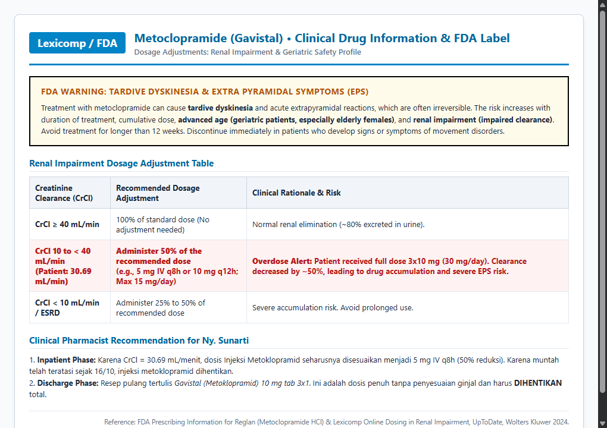
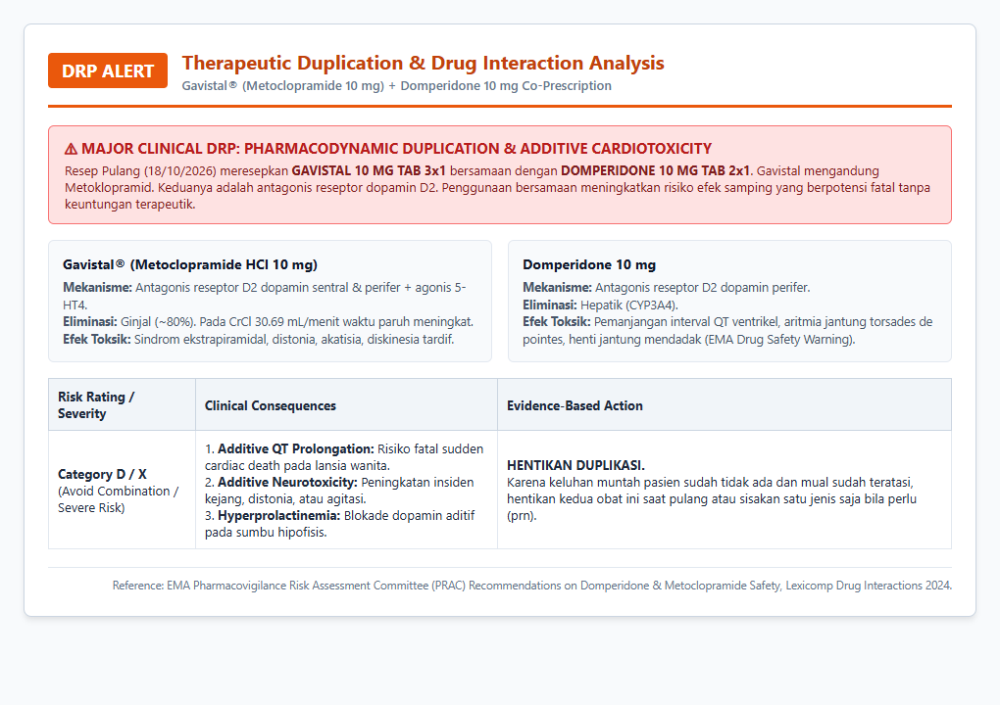
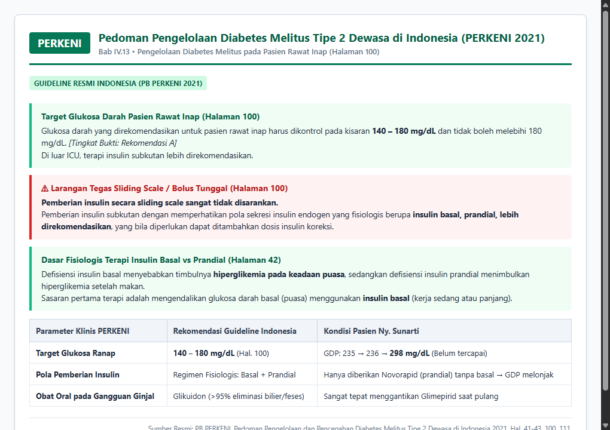
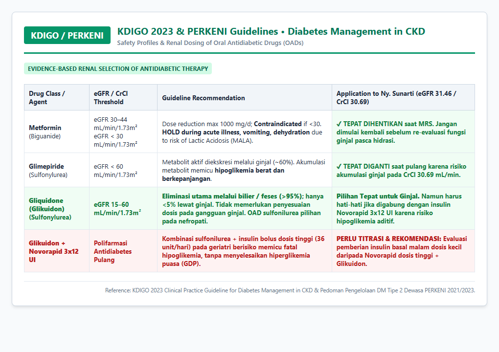
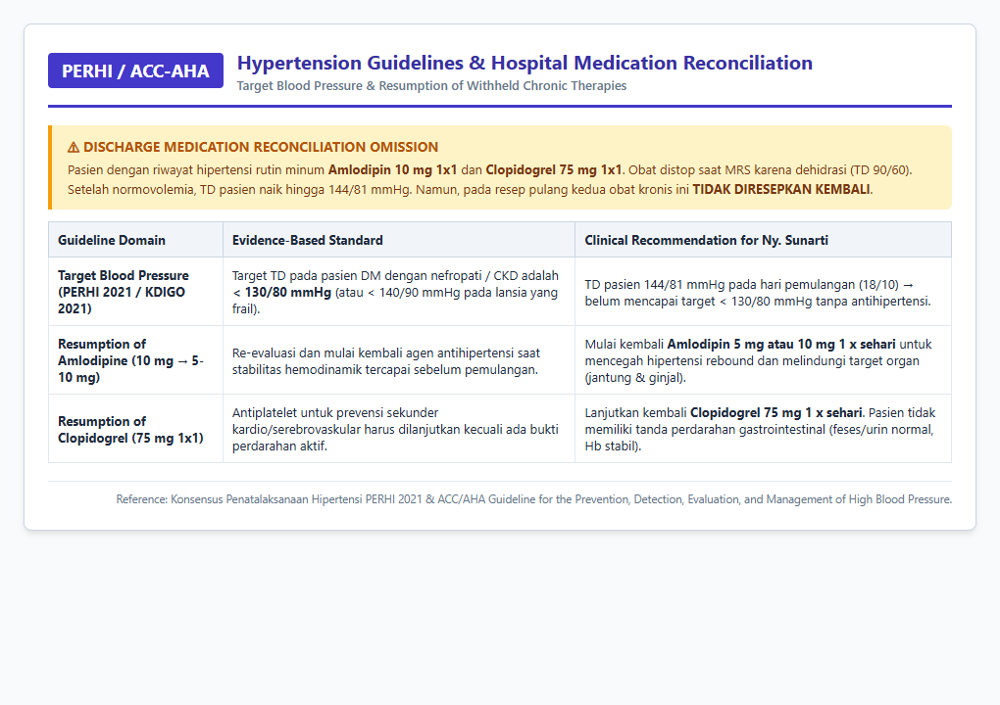

# LAPORAN LENGKAP PEMANTAUAN TERAPI OBAT (PTO) PASIEN RAWAT INAP
**Instalasi Farmasi Klinis &bull; Bangsal Rawat Inap Merak (Kamar 314 / Bed 14A)**  
**RSPAU dr. S. Hardjolukito Yogyakarta**

---

## I. PROFIL & DATA DEMOGRAFI PASIEN

| Parameter | Data Pasien | Parameter | Data Pasien |
| :--- | :--- | :--- | :--- |
| **Nama Pasien** | **Ny. SUNARTI** | **No. Rekam Medis (RM)** | **00109480** |
| **Tanggal Lahir / Usia** | 18 November 1963 / 62 tahun 10 bulan (~63 th) &bull; *Geriatri* | **Jenis Kelamin** | Perempuan |
| **Berat Badan / Tinggi Badan** | 60 kg / 156 cm | **Indeks Massa Tubuh (IMT)** | 24,65 kg/m² (*Normoweight*) |
| **Tanggal Masuk RS** | 14 Oktober 2026 (Pukul 20:45 WIB) | **Tanggal Keluar RS** | 18 Oktober 2026 (Pukul 14:00 WIB &bull; BLPL) |
| **Ruang Rawat / Bed** | Merak / 314 &bull; Bed 14A | **DPJP** | dr. Raden Triyono Edhi Sulistiyanto, Sp.PD., FINASIM |
| **Riwayat Alergi Obat** | **AMOKSISILIN & AMPISILIN** | **Reaksi Alergi** | Ruam kemerahan dan gatal di kulit |
| **Diagnosis Utama** | **Vomitus Profuse ec dalam pelacakan** *(suspek food intoxication / GEA akut)* | | |
| **Diagnosis Sekunder** | 1. Diabetes Melitus Tipe 2 dengan Hiperglikemia<br>2. Riwayat Hipertensi<br>3. Hiponatremia & Hipokloremia Ringan ec dehidrasi<br>4. Anorexia Geriatri<br>5. ISPA (Infeksi Saluran Pernapasan Akut) | | |
| **Riwayat Penyakit Dahulu (RPD)** | 1. DM Tipe 2 terkontrol obat rutin<br>2. Hipertensi terkontrol obat rutin<br>3. Riwayat Vertigo<br>4. Post-Op Phaco + IOL OS a.i Katarak Komplikata (04/08/2026) | | |
| **Riwayat Penggunaan Obat (RPO)** | **Obat Rutin Poli Penyakit Dalam (09/10/2026):**<br>- Amlodipin 1 x 10 mg PO pagi<br>- Clopidogrel 1 x 75 mg PO pagi<br>- Glimepirid 1 x 3 mg PO pagi ac<br>- Metformin 1 x 500 mg PO malam dc<br><br>**Obat dari UGD RSPAU (11/10/2026 saat periksa awal):**<br>- Becom C 1 x 1 tablet PO<br>- Betahistin 3 x 6 mg tablet PO<br>- Ibuprofen 2 x 400 mg tablet PO (NSAID) | | |

---

## II. DAFTAR LENGKAP DRUG RELATED PROBLEMS (DRP) TERIDENTIFIKASI

Berdasarkan telaah rekam medis terpadu (Asesmen Awal IGD, CPPT Harian Dokter, Perawat, Ahli Gizi, Apoteker, Hasil Laboratorium, Radiologi, hingga Resep Pulang), ditemukan **10 Drug Related Problems (DRP)** yang diklasifikasikan menggunakan standar internasional **PCNE (*Pharmaceutical Care Network Europe*)**:

| No | Kategori DRP (PCNE) | Obat Terkait | Temuan Klinis & Permasalahan | Tingkat Keparahan | Rekomendasi Farmasis Klinis |
| :---: | :--- | :--- | :--- | :---: | :--- |
| **1** | **Dosis Berlebih pada Gangguan Ginjal** (*PCNE C3.1 / P1.2*) | **Injeksi Metoklopramid** 3 x 10 mg IV (30 mg/hari) | Pasien mengalami penurunan fungsi ginjal akut (*CrCl* **30,69 mL/menit**, *eGFR* **31,46 mL/min/1.73m²**). Metoklopramid diekskresi >80% via ginjal. Waktu paruh meningkat 3x lipat, memicu risiko tinggi efek samping ekstrapiramidal (EPS) dan *Tardive Dyskinesia* (FDA Boxed Warning) pada wanita lansia. | **Tinggi (Major)** | Turunkan dosis metoklopramid sebesar 50% (5 mg IV q8h atau 10 mg q12h; maks 15 mg/hari) sesuai Lexicomp/FDA. Karena muntah telah berhenti sejak 16/10, rekomendasikan **HENTIKAN terapi metoklopramid**. |
| **2** | **Duplikasi Terapi Inap Berbahaya** (*PCNE C1.3 / P2.1*) | **Injeksi Metoklopramid** 3 x 10 mg IV + **Domperidone tab** 2 x 10 mg PO (tgl 17–18/10) | Keduanya adalah **Antagonis Reseptor Dopamin D2**. Terjadi duplikasi mekanisme kerja tanpa keuntungan klinis, yang melipatgandakan risiko **pemanjangan interval QT (aritmia ventrikel fatal / Torsades de Pointes)** dan neurotoksisitas EPS. | **Tinggi (Major)** | **Hentikan Domperidone oral** dan tapering/stop injeksi metoklopramid karena keluhan mual/muntah pasien sudah sangat berkurang. |
| **3** | **Regimen Antidiabetes Inap Kurang Optimal** (*PCNE C1.4 / P1.2*) | **Novorapid (Insulin Aspart)** SC 3x8 UI $\rightarrow$ 3x10 UI $\rightarrow$ 3x12 UI (tanpa insulin basal) | Kadar GDP puasa terus meningkat selama rawat inap (16/10: 235 mg/dL; 17/10: 236 mg/dL; 18/10: **298 mg/dL**). Novorapid hanya bekerja 3–5 jam untuk makan. Tanpa insulin basal, produksi glukosa hepatik malam–pagi hari tidak tertahan. Target PERKENI 2021 / ADA rawat inap (140–180 mg/dL) gagal tercapai. | **Signifikan** | Terapkan regimen **Basal-Bolus** sesuai Pedoman PERKENI 2021 (Hal. 100): berikan insulin basal kerja panjang (Insulin Glargine 8–10 unit 1x malam) dikombinasikan dengan insulin prandial dosis terkontrol (Novorapid 3x4–6 unit ac). |
| **4** | **Indikasi Belum Diterapi** (*PCNE C1.1 / P1.2*) | Batuk berdahak putih (ISPA) | Pasien mengeluhkan batuk berdahak putih persisten sejak masuk hingga hari ke-3 (diagnosis sekunder: ISPA), namun tidak mendapatkan terapi mukolitik maupun ekspektoran sama sekali. Retensi sputum pada lansia berisiko superinfeksi saluran napas. | **Sedang** | Berikan mukolitik oral: **Ambroxol 3 x 30 mg tablet** atau **N-Asetilsistein 3 x 200 mg kapsul** selama 3–5 hari hingga dahak tuntas. |
| **5** | **Pemilihan Obat Nefrotoksik Sebelumnya** (*PCNE C1.2 / P2.1*) | **Ibuprofen** 2 x 400 mg tab (diberikan UGD tgl 11/10/2026) | Pasien lansia dengan dehidrasi berat dari muntah profus diberikan NSAID dosis penuh. Ibuprofen menghambat prostaglandin vasodilator di arteriol aferen ginjal, memicu penurunan perfusi glomerulus dan mempercepat terjadinya AKI prerenal (Ureum 57, Cr 1,80 mg/dL). | **Signifikan** | Hindari NSAID pada kondisi dehidrasi dan gangguan ginjal. Gunakan **Parasetamol 500 mg PO prn (maks 2 g/hari pada lansia)** jika memerlukan analgesik/antipiretik. |
| **6** | **DUPLIKASI FATAL RESEP PULANG** (*PCNE C1.3 / P2.1*) | **GAVISTAL 10 mg tab** 3x1 + **DOMPERIDONE 10 mg tab** 2x1 (Resep Pulang IRJ-261018-87885) | **GAVISTAL adalah nama dagang METOCLOPRAMIDE 10 mg!** Resep pulang meresepkan Metoklopramid 3x10 mg bersamaan dengan Domperidone 2x10 mg untuk dibawa pulang. Ini adalah duplikasi berbahaya kelas antagonis dopamin D2 pada pasien gagal ginjal moderat (CrCl 30,69 mL/mnt) dengan risiko aritmia jantung dan distonia/diskinesia tardif di rumah. | **KRITIS (Major Alert)** | **BATALKAN GAVISTAL DAN DOMPERIDONE PADA RESEP PULANG.** Pasien saat pulang menyatakan sudah TAK (Tidak Ada Keluhan) dan minta pulang, sehingga prokinetik/antiemetik rutin sudah tidak diperlukan. |
| **7** | **OMISSION TERAPI KRONIS SAAT PULANG** (*PCNE C1.1 / P1.2*) | **Amlodipin 10 mg** dan **Clopidogrel 75 mg** (Obat rutin terabaikan) | Pasien memiliki riwayat hipertensi rutin minum Amlodipin 10 mg 1x1 dan Clopidogrel 75 mg 1x1. Obat distop saat MRS karena hipotensi dehidrasi (TD 90/60). Saat pulang (18/10), TD pasien mencapai **144/81 mmHg**, tetapi **kedua obat ini TIDAK DIRESEPKAN KEMBALI** pada resep pulang. Pasien berisiko hipertensi rebound dan komplikasi kardiovaskular tak terproteksi. | **KRITIS (Major Alert)** | Lakukan rekonsiliasi pemulangan: **Mulai kembali Amlodipin 5–10 mg 1 x sehari pagi** (target TD < 130/80 mmHg) dan **Clopidogrel 75 mg 1 x sehari**. |
| **8** | **Kombinasi Terapi DM Pulang Berisiko Hipoglikemia Berat** (*PCNE C1.4 / P2.1*) | **Glikuidon 30 mg** 1x1 tab pagi ac + **Novorapid Flexpen** 3 x 12 UI ac (total 36 UI/hari) | Menggabungkan Sulfonilurea (Glikuidon) bersama insulin prandial dosis tinggi (36 UI/hari) pada pasien geriatri pasca anoreksia sangat berisiko memicu **hipoglikemia berat yang fatal**. Selain itu, jarum suntik Novofine di resep pulang hanya ditulis 1 buah (padahal suntik 3x sehari). | **Tinggi (Safety Alert)** | Evaluasi penyederhanaan regimen: Jika makan sudah baik, optimalkan **Glikuidon 30 mg 1–2x/hari ac**. Jika butuh insulin, berikan insulin basal malam dosis kecil (Glargine 8–10 unit) daripada Novorapid 3x12 UI + Glikuidon. Sediakan jarum yang cukup dan berikan edukasi hipoglikemia. |
| **9** | **Polifarmasi Saluran Cerna Pulang Berlebih** (*PCNE C1.3*) | 5 macam obat lambung pulang: Antasida syr, Omeprazole 2x20 mg, Rebamipide 3x1, Domperidone 2x1, Gavistal 3x1 | Pasien dipulangkan dengan 5 macam obat pencernaan untuk kasus intoksikasi susu jahe akut yang sudah sembuh total tanpa perdarahan ulkus. Ini adalah pemborosan terapi (*overtreatment*) dan membebani ginjal/kepatuhan lansia. | **Sedang** | Sederhanakan: Cukup berikan **Omeprazole 20 mg kapsul 1 x sehari pagi ac** selama 5–7 hari untuk proteksi sisa iritasi. Hentikan Antasida sirup, Rebamipide, Domperidone, dan Gavistal. |
| **10** | **Ketiadaan Pemantauan Lab Kontrol Pasca-Tindakan** (*PCNE C3.5*) | Elektrolit darah (Na, Cl) dan Fungsi Ginjal (Ureum, Kreatinin) | Pasien masuk dengan hiponatremia (Na 127,36), hipokloremia (Cl 87,75), dan kreatinin 1,80 mg/dL. Setelah diinfus NaCl 0,9% selama 4 hari, **TIDAK ADA pemeriksaan laboratorium ulang** sebelum pasien dipulangkan untuk memastikan perbaikan elektrolit dan menilai apakah AKI reversibel atau menetap. | **Signifikan** | Jadwalkan evaluasi laboratorium lengkap (Ureum, Kreatinin, Na, K, Cl, HbA1c, dan GDP/GD2PP) saat kontrol ke Poli Penyakit Dalam 1 minggu pasca rawat inap. |

---

## III. ANALISIS MENDALAM KONDISI PASIEN & TANDA-TANDA VITAL (TTV)

### A. Dinamika Hemodinamik & Resusitasi Klinis
1. **Fase Syok Hipovolemik / Dehidrasi Awal (14 Oktober 2026):**
   * Di Klinik Pratama Ramadhan: Tekanan darah anjlok ke **90/60 mmHg**, GDS **294 mg/dL**, kondisi pasien lemas berat tak berdaya.
   * Di IGD RSPAU: Tekanan darah **101/80 mmHg**, Nadi **105 x/menit** (takikardia kompensasi dehidrasi berat), Frekuensi Nafas **22 x/menit** (takipnea kompensasi asidosis metabolik/dehidrasi), Suhu 36,0°C, SpO2 96%.
   * *Analisis Patofisiologis:* Muntah profus >10 kali per hari selama 3 hari berturut-turut menyebabkan deplesi cairan ekstraseluler dan intravaskular yang parah. Penurunan *effective circulating volume* ini memicu aktivasi sistem saraf simpatis (takikardia 105 x/m) dan vasokonstriksi perifer guna mempertahankan perfusi organ vital.
2. **Fase Resusitasi & Pemulihan (15 s/d 18 Oktober 2026):**
   * Pasien menerima terapi hidrasi kristaloid berupa Infus NaCl 0,9% loading 500 cc lanjut pemeliharaan 20 tetes/menit.
   * Pada H1 Rawat Inap (15/10), tekanan darah melonjak ke **149/70 mmHg** dan denyut nadi melambat ke 92 x/menit, menandakan volume intravaskular mulai terisi kembali.
   * Keluhan muntah berhasil teratasi sejak hari ke-2 (16/10 muntah (-)). Pada 18/10 pasien menyatakan sudah **TAK (Tidak Ada Keluhan)**, mual hilang, dan meminta izin pulang.
   * Pada pagi hari tanggal 18/10 sebelum pemulangan, TD pasien tercatat **144/81 mmHg**, Nadi 94 x/menit, Suhu 37,5°C. Kondisi ini membuktikan bahwa hipovolemia sudah teratasi penuh, dan tekanan darah dasar pasien kembali ke level hipertensi yang membutuhkan antihipertensi rutin (Amlodipin).

### B. Tabel Pemantauan Tanda-Tanda Vital (TTV) Harian

| Parameter Vital | Target Nilai Normal | IGD (14/10) | H1 Ranap (15/10) | H2 Ranap (16/10) | H3 Ranap (17/10) | H4 / Pulang (18/10) | Catatan & Analisis Klinis |
| :--- | :---: | :---: | :---: | :---: | :---: | :---: | :--- |
| **Sistole (mmHg)** | < 130 (Target DM/CKD) | 101 (90 di klinik) | 149 | 125 &ndash; 113 | 122 &ndash; 140 | **144** &rarr; 122 | Terjadi pemulihan dari hipotensi dehidrasi menuju hipertensi rebound |
| **Diastole (mmHg)** | < 80 | 80 (60 di klinik) | 70 | 66 &ndash; 67 | 65 &ndash; 79 | **81** &rarr; 82 | Diastole stabil setelah koreksi cairan kristaloid |
| **Nadi (x/menit)** | 60 &ndash; 100 | **105** (Takikardia) | 92 | 90 &ndash; 95 | 81 &ndash; 99 | 88 &ndash; 94 | Takikardia kompensatorik teratasi seiring normovolemia |
| **Pernapasan (x/mnt)**| 12 &ndash; 20 | **22** (Takipnea) | 20 | 20 | 20 | 20 | Takipnea ringan mereda ke batas normal |
| **Suhu Tubuh (&deg;C)**| 36,5 &ndash; 37,5 | 36,0 | 36,5 | 36,2 &ndash; 36,4 | 36,0 &ndash; 36,5 | 36,0 &ndash; 37,5 | Pasien afebris sepanjang rawat inap |
| **SpO2 (%)** | &ge; 95% | 96% | 96% | 95% &ndash; 98% | 98% &ndash; 99% | 99% | Oksigenasi jaringan sangat baik dengan *room air* |
| **Status Keluhan** | Tidak ada | Muntah >10x, mual+++ | Mual++, lemas, batuk+ | Muntah (-), mual+, batuk+ | Mual berkurang, batuk (-) | **TAK (Minta Pulang)** | Perbaikan klinis saluran cerna tercapai |

---

## IV. ANALISIS MENDALAM HASIL LABORATORIUM (ORGAN PER ORGAN)

### A. Diagram Tren Kadar Glukosa Darah Pasien

```
                      TREN KADAR GLUKOSA DARAH PASIEN (mg/dL)
 350 ┼────────────────────────────────────────────────────────
     │  310 (GDS Awal 14/10)                                 298 (GDP H4 18/10)
 300 ┼──●─────────────────────────────────────────────────────●──
     │                                235 (GDP)    236 (GDP)
 250 ┼─────────────────────────────────●────────────●─────────
     │                208 (GDS H1)
 200 ┼─────────────────●──────────────────────────────────────
     │  ═══════════════════════════════════════════════════════ TARGET PERKENI: 180 mg/dL
 150 ┼────────────────────────────────────────────────────────
     │  ────────────────────────────────────────────────────── TARGET PERKENI: 140 mg/dL
 100 ┼────────────────────────────────────────────────────────
     └──────┬──────────────┬──────────────┬───────────┬───────
          14/10          15/10          16/10       17/10   18/10
```

### B. Analisis Laboratorium Organ per Organ

#### 1. Parameter Karbohidrat / Glukosa Darah (Mengapa Gagal Mengontrol GDP?)
* **Data Hasil Pemeriksaan:**
  * GDS saat Masuk (14/10/2026): **310 mg/dL** (Tinggi, rujukan < 200 mg/dL)
  * GDS Hari ke-1 (15/10/2026): **208 mg/dL**
  * GDP Hari ke-2 (16/10/2026): **235 mg/dL** (Tinggi, rujukan 70–115 mg/dL)
  * GDP Hari ke-3 (17/10/2026): **236 mg/dL**
  * GDP Hari ke-4 / Pulang (18/10/2026): **298 mg/dL**!
* **Target Panduan PERKENI 2021 (*Pengelolaan DM Rawat Inap Hal. 100*):** **140 – 180 mg/dL** (7,8 – 10,0 mmol/L) untuk pasien rawat inap non-kritis.
* **Apa yang Salah:** Terjadi kegagalan terapi kontrol glikemik puasa (*fasting glycemic failure*) yang nyata. Kadar GDP puasa pagi hari terus naik dari 208 $\rightarrow$ 235 $\rightarrow$ 236 $\rightarrow$ **298 mg/dL**, padahal dokter DPJP telah menaikkan dosis injeksi Novorapid dari 3x8 UI $\rightarrow$ 3x10 UI $\rightarrow$ 3x12 UI (total 36 UI/hari).
* **Mekanisme Farmakologis & Patofisiologis:**
  * Novorapid adalah insulin analog kerja cepat (*rapid-acting insulin aspart*). Profil farmakokinetiknya: Onset 10–20 menit, puncak kerja 1–3 jam, dan durasi kerja hanya **3–5 jam**. Novorapid semata-mata mengontrol lonjakan glukosa darah pasca makan (*postprandial glucose excursion*).
  * Pasien **SAMA SEKALI TIDAK DIBERIKAN INSULIN BASAL** (seperti Insulin Glargine, Detemir, atau Degludec).
  * Pada rentang puasa malam hari (antara makan malam pukul 18.00 hingga pemeriksaan laboratorium pukul 06.00–07.00 pagi), efek Novorapid sudah habis total. Ketiadaan insulin basal memicu proses glukoneogenesis dan glikogenolisis hepatik tanpa hambatan sepanjang malam, sehingga saat bangun pagi glukosa darah puasa (GDP) melonjak drastis hingga 298 mg/dL.
  * Menitrasi dosis Novorapid hingga 12 unit per kali suntik (36 unit/hari) tanpa basal adalah keliru: glukosa darah puasa tetap tidak terkontrol, sementara risiko hipoglikemia prandial siang/sore hari meningkat drastis.
* **Apa yang Harus Diperbaiki:** Menghentikan strategi bolus-tunggal dan menerapkan regimen **Basal-Bolus** sesuai ADA Standards of Care: tambahkan insulin basal (misal Insulin Glargine 8–10 unit subkutan malam jam 22.00) dan turunkan Novorapid ke dosis prandial fisiologis (3 x 4–6 unit sebelum makan).

#### 2. Parameter Fungsi Ginjal (Ureum, Kreatinin, & AKI Prerenal)
* **Data Hasil Pemeriksaan:**
  * Ureum Darah: **57 mg/dL** (Tinggi, nilai rujukan: 21 – 43 mg/dL)
  * Kreatinin Serum: **1,80 mg/dL** (Tinggi, nilai rujukan: 0,6 – 1,1 mg/dL)
* **Perhitungan Laju Filtrasi Ginjal:**
  $$\text{CrCl (Cockcroft-Gault)} = \frac{(140 - 62) \times 60 \text{ kg}}{72 \times 1,80 \text{ mg/dL}} \times 0,85 = \frac{4680}{129,6} \times 0,85 = \mathbf{30,69 \text{ mL/menit}}$$
  $$\text{eGFR (CKD-EPI 2021)} = \mathbf{31,46 \text{ mL/min/1,73m}^2} \quad (\text{Stadium G3b &ndash; Gangguan Sedang hingga Berat})$$
* **Analisis Patofisiologis Penyebab:**
  * Terjadi **Acute Kidney Injury (AKI) Prerenal / Azotemia Prerenal** akibat deplesi volume cairan ekstraseluler dari vomitus profus >10 kali/hari selama 3 hari.
  * Penurunan fungsi ginjal ini diperparah oleh konsumsi **Ibuprofen 2 x 400 mg** dari UGD tgl 11/10/2026. Golongan NSAID menghambat enzim siklooksigenase (COX-1 dan COX-2), sehingga produksi prostaglandin renal vasodilator (PGE2 dan PGI2) terhenti. Pada kondisi dehidrasi, perfusi ginjal sangat bergantung pada vasodilatasi arteriol aferen oleh prostaglandin. Akibat hambatan ini, arteriol aferen berkonstriksi hebat, tekanan filtrasi glomerulus anjlok, dan timbul azotemia prerenal akut.
* **Implikasi Farmasi & Hal yang Harus Diperbaiki:**
  1. Penyesuaian dosis wajib dilakukan pada obat-obat yang dieliminasi via ginjal, khususnya **Metoklopramid** (harus diturunkan 50% atau dihentikan).
  2. Keputusan dokter menghentikan **Metformin** saat masuk RS sudah tepat, karena pada eGFR ~31 mL/min/1.73m² dan kondisi dehidrasi, risiko terjadinya *Metformin-Associated Lactic Acidosis (MALA)* sangat mematikan.
  3. Keputusan dokter mengganti **Glimepirid** saat pulang sudah tepat karena metabolit aktif glimepirid terakumulasi di ginjal; digantikan oleh **Glikuidon** yang eliminasi utamanya via bilier/feses (95%).
  4. *Kelemahan Penanganan:* Kadar Ureum dan Kreatinin **tidak pernah diperiksa ulang** sebelum pasien dipulangkan untuk memastikan apakah AKI prerenal sudah pulih sempurna pasca rehidrasi.

#### 3. Parameter Elektrolit Serum (Dehidrasi & Kehilangan Asam Lambung)
* **Data Hasil Pemeriksaan:**
  * Natrium (Na): **127,36 mmol/L** (Rendah / Hiponatremia ringan-sedang, rujukan: 135,0 – 147,0 mmol/L)
  * Klorida (Cl): **87,75 mmol/L** (Rendah / Hipokloremia, rujukan: 95,0 – 105,0 mmol/L)
  * Kalium (K): **4,23 mmol/L** (Normal, rujukan: 3,5 – 5,5 mmol/L)
* **Analisis Patofisiologis:** Muntah berulang secara masif menyebabkan kehilangan asam lambung (HCl) dan cairan cerna yang kaya natrium secara signifikan. Hal ini menimbulkan **hiponatremia dan hipokloremia hipovolemik**.
* **Terapi & Hal yang Harus Diperbaiki:** Rehidrasi dengan kristaloid isotonik (Infus NaCl 0,9% 20 tetes/menit) merupakan pilihan yang sangat tepat untuk menggantikan ion Na dan Cl. Namun, **kadar elektrolit tidak pernah dievaluasi ulang** pasca terapi cairan untuk memverifikasi apakah ion Na dan Cl telah kembali ke batas normal.

#### 4. Parameter Hematologi & Fungsi Hati
* **Hemoglobin 11,6 g/dL** (Sedikit rendah, rujukan wanita: 11,7 – 15,5 g/dL) dan **Hematokrit 33,9%** (Rendah, rujukan: 35 – 47%). Indeks eritrosit menunjukkan MCV normal (86,3 fL), MCH normal (29,5 pg), dan MCHC normal (34,2 g/dL). Kesimpulan: **Anemia normositik normokrom ringan**, kemungkinan besar akibat kombinasi anemia penyakit kronis (*anemia of chronic disease* terkait DM/CKD) dan hemodilusi fisiologis pasca rehidrasi cairan infus. Tidak memerlukan transfusi, cukup dipantau berkala.
* **Leukosit 4.850 /mm³** dan **Trombosit 239.000 /mm³** berada dalam rentang normal, menyingkirkan dugaan infeksi sistemik berat/sepsis maupun trombositopenia.
* **SGOT 39 U/L** (sedikit meningkat, rujukan < 35 U/L) dan **SGPT 23 U/L** (normal, rujukan < 34 U/L). Peningkatan transient SGOT disebabkan oleh hipoperfusi seluler sesaat saat syok dehidrasi atau *non-alcoholic fatty liver disease (NAFLD)* ringan yang lazim pada pasien DM tipe 2.

---

## V. PENYESUAIAN DOSIS BERDASARKAN GUIDELINE RESMI & BUKTI SCREENSHOT

### A. Metoklopramid (Gavistal) pada Gangguan Ginjal & Peringatan Ekstrapiramidal
* **Guideline Acuan:** **FDA Approved Prescribing Information for Reglan (Metoclopramide)** & **Lexicomp Clinical Drug Information (Wolters Kluwer / UpToDate 2024)**.
* **Aturan Penyesuaian Dosis Ginjal:**
  * CrCl $\ge$ 40 mL/menit: 100% dari dosis lazim (tanpa penyesuaian).
  * **CrCl 10 s/d < 40 mL/menit (Pasien: 30,69 mL/menit):** **Wajib diturunkan sebesar 50% dari dosis harian lazim** (dosis yang direkomendasikan: 5 mg IV setiap 8 jam, atau 10 mg IV setiap 12 jam; dosis maksimal harian $\le$ 15 mg/hari).
  * CrCl < 10 mL/menit / Hemodialisis: Berikan 25%–50% dosis lazim.
* **Peringatan Keamanan Kritis (*FDA Boxed Warning*):**
  Metoklopramid memiliki peringatan *Black Box* terkait risiko **Tardive Dyskinesia** dan reaksi ekstrapiramidal berat lainnya. Faktor risiko utama mencakup: durasi penggunaan lama, dosis kumulatif tinggi, **pasien geriatri (terutama wanita lansia)**, dan **gangguan fungsi ginjal** akibat hambatan ekskresi obat.
* **Rekomendasi Farmasis Klinis:**
  * Dosis rawat inap 3 x 10 mg IV (30 mg/hari) adalah *overdose* relatif pada pasien dengan CrCl 30,69 mL/menit. Dosis seharusnya diturunkan 50% menjadi 5 mg IV q8h.
  * Karena keluhan muntah sudah berhenti sejak 16/10 dan pasien sudah tidak mual saat pulang (TAK), **HENTIKAN METOKLOPRAMID (GAVISTAL) SECARA TOTAL**.



---

### B. Intervensi Duplikasi Terapi Antiemetik: Gavistal (Metoklopramid) + Domperidone
* **Guideline Acuan:** **EMA Pharmacovigilance Risk Assessment Committee (PRAC)** & **Lexicomp Drug Interaction Analysis (Risk Rating: D / X - Avoid Combination)**.
* **Temuan Resep Pulang (No. IRJ-261018-87885):**
  1. GAVISTAL 10 MG TAB 3 x 1 ac
  2. DOMPERIDONE 10 MG TAB 2 x 1 ac
* **Analisis Farmakologi:**
  * **GAVISTAL mengandung zat aktif METOCLOPRAMIDE 10 mg!**
  * Metoklopramid dan Domperidone keduanya merupakan **Antagonis Reseptor Dopamin D2**. Peresepan keduanya secara bersamaan adalah bentuk duplikasi terapi (*therapeutic redundancy*) tanpa keuntungan klinis aditif.
  * Kombinasi ini melipatgandakan risiko efek toksik fatal:
    1. **Pemanjangan Interval QTc & Aritmia Ventrikel Fatal (*Torsades de Pointes*):** Domperidone memiliki peringatan keamanan ketat dari EMA dan FDA terkait henti jantung mendadak akibat pemanjangan QT, yang risikonya meningkat tajam bila dikombinasikan dengan sesama obat pemanjang QT pada wanita lansia.
    2. **Sindrom Ekstrapiramidal (EPS) & Neurotoksisitas:** Blokade dopamin sentral ganda pada otak memicu distonia akut, akatisia, tremor, dan parkinsonisme obat.
* **Rekomendasi Farmasis Klinis:** **BATALKAN KEDUA OBAT PADA RESEP PULANG.** Pasien sudah menyatakan tidak mual/muntah (TAK) saat pulang, sehingga prokinetik/antiemetik rutin sudah tidak diindikasikan.



---

### C. Penyesuaian Regimen Insulin Rawat Inap & Target PERKENI 2021 (140–180 mg/dL)
* **Guideline Acuan:** **Pedoman Pengelolaan dan Pencegahan Diabetes Melitus Tipe 2 Dewasa di Indonesia (PB PERKENI 2021 &bull; Bab IV.13 Hal. 100)**.
* **Rekomendasi Standar ADA:**
  * **Rekomendasi 16.4:** Terapi insulin dimulai bila glukosa darah persisten $\ge$ 180 mg/dL. Begitu dimulai, target rentang glukosa darah rawat inap untuk sebagian besar pasien kritis dan non-kritis adalah **140 – 180 mg/dL** (7,8 – 10,0 mmol/L).
  * **Rekomendasi 16.5:** Regimen standar emas untuk pasien rawat inap non-kritis dengan asupan makan adekuat adalah **Basal-Bolus** (kombinasi insulin basal kerja panjang ditambah insulin prandial kerja cepat sebelum makan dan dosis koreksi).
  * **Larangan Tegas ADA:** *Sole reliance on sliding-scale insulin or rapid-acting bolus insulin alone without basal insulin is strongly discouraged* (sangat tidak dianjurkan).
* **Kalkulasi Dosis Regimen Basal-Bolus yang Tepat untuk Pasien (BB 60 kg):**
  * Total Daily Dose (TDD) awal untuk pasien lansia dengan penurunan fungsi ginjal: 0,3 unit/kgBB/hari.
  * $\text{TDD} = 60 \text{ kg} \times 0,3 = \mathbf{18 \text{ unit/hari}}$.
  * **Komponen Basal (50% dari TDD):** **9 unit Insulin Glargine** (Lantus) subkutan 1 x sehari pada malam hari pukul 22.00 (berfungsi menekan glukosa darah puasa malam–pagi).
  * **Komponen Prandial (50% dari TDD):** 9 unit dibagi untuk 3 kali makan = **Novorapid 3 x 3 unit** subkutan sebelum makan (sarapan 3 unit, makan siang 3 unit, makan malam 3 unit), ditambah dosis koreksi bila glukosa darah sebelum makan > 180 mg/dL.



---

### D. Pemilihan Antidiabetes pada Gangguan Ginjal (Metformin vs Glikuidon)
* **Guideline Acuan:** **KDIGO 2023 Clinical Practice Guideline for Diabetes Management in Chronic Kidney Disease** & **Konsensus Pengelolaan DM Tipe 2 PERKENI 2021/2023**.
* **Prinsip Dosis Berdasarkan eGFR Pasien (31,46 mL/min/1.73m²):**
  * **Metformin:** Pada eGFR 30–44 mL/min/1.73m², dosis maksimal harian 1.000 mg/hari; kontraindikasi mutlak jika eGFR < 30 mL/min/1.73m². **Wajib dihentikan (*hold*) saat kondisi akut dehidrasi, muntah berat, atau infeksi sistemik** untuk mencegah asidosis laktat (*MALA*).
  * **Glimepirid:** Memiliki metabolit aktif (M1) yang diekskresi via ginjal (~60%). Pada CrCl < 60 mL/menit, metabolit ini terakumulasi dan menyebabkan hipoglikemia berat yang berkepanjangan (*prolonged hypoglycemia*).
  * **Glikuidon (Gliquidone):** Merupakan sulfonilurea pilihan utama pada gangguan fungsi ginjal karena **>95% dieliminasi melalui rute hepatobilier (saluran empedu dan feses)**, dan hanya <5% lewat urin. Tidak memerlukan penyesuaian dosis pada eGFR 15–60 mL/min/1.73m².
* **Rekomendasi Farmasis Klinis:**
  * Penggantian Glimepirid ke Glikuidon 30 mg 1x1 pagi sudah sangat tepat untuk profil ginjal pasien.
  * **PERINGATAN RESEP PULANG:** Meresepkan Glikuidon 30 mg bersamaan dengan Novorapid 3 x 12 UI (36 unit/hari) pada resep pulang sangat berisiko memicu hipoglikemia fatal di rumah. Evaluasi penyederhanaan regimen: cukup Glikuidon 30 mg 1–2 kali sehari sebelum makan jika asupan makan stabil, atau jika butuh insulin, gunakan insulin basal malam dosis kecil daripada Novorapid dosis masif.



---

### E. Target Tekanan Darah & Rekonsiliasi Terapi Kronis Pulang
* **Guideline Acuan:** **Konsensus Penatalaksanaan Hipertensi PERHI 2021** & **ACC/AHA / KDIGO Blood Pressure Guideline**.
* **Standar Bukti Klinis:**
  * Target tekanan darah untuk pasien diabetes melitus dengan nefropati / CKD adalah **< 130/80 mmHg** (atau < 140/90 mmHg pada lansia).
  * *Discharge Medication Reconciliation:* Obat antihipertensi (Amlodipin) dan antiplatelet (Clopidogrel) yang dihentikan sementara saat kondisi hipotensi/dehidrasi akut **WAJIB DIREKONSILIASI DAN DIMULAI KEMBALI** begitu pasien mencapai normovolemia dan stabilitas hemodinamik sebelum pemulangan.
* **Rekomendasi Farmasis Klinis:**
  * Tekanan darah pasien pada pagi hari kepulangan (18/10) tercatat **144/81 mmHg**, membuktikan bahwa pasien membutuhkan kelanjutan terapi antihipertensi.
  * Resep pulang yang mengabaikan (*omitted*) Amlodipin dan Clopidogrel harus segera diperbaiki: **Mulai kembali Amlodipin 5–10 mg 1 x sehari pagi** dan **Clopidogrel 75 mg 1 x sehari**.



---

## VI. TABEL REKONSILIASI RESEP PULANG (DOKTER VS APOTEKER)

Berikut adalah perbandingan berdampingan antara resep pulang yang dituliskan dokter DPJP dengan rekomendasi rekonsiliasi yang rasional dan aman dari Apoteker Klinis:

| No | Resep Pulang Aktual Dokter (No. IRJ-261018-87885) | Rekomendasi Rekonsiliasi Apoteker Klinis | Alasan Klinis & Pertimbangan Berbasis Bukti |
| :---: | :--- | :--- | :--- |
| **1** | **GAVISTAL 10 MG TAB** (15 tab, 3x1 ac) | **BATALKAN (STOP)** | Gavistal adalah Metoklopramid 10 mg. Mual muntah sudah sembuh total (TAK). Berisiko akumulasi ginjal dan diskinesia tardif pada geriatri. |
| **2** | **DOMPERIDONE 10 MG TAB** (14 tab, 2x1 ac) | **BATALKAN (STOP)** | Duplikasi fatal dengan Gavistal (keduanya antagonis D2). Berisiko tinggi pemanjangan interval QT aritmia ventrikel. |
| **3** | **Antasida Sirup** (1 btl, 3x1 C ac) | **BATALKAN (STOP)** | Polifarmasi tidak perlu; penyakit akut susu jahe sudah sembuh. Antasida dapat mengikat obat kronis lain dan menghambat absorpsinya. |
| **4** | **Rebamipide 100 mg tab** (15 tab, 3x1 ac) | **BATALKAN (STOP)** | Overtreatment pelindung lambung pada pasien non-ulkus yang sudah remisi klinis. |
| **5** | **Omeprazole 20 mg kap** (10 kap, 2x1 ac) | **Ganti: Omeprazole 1 x 20 mg kapsul pagi (1 jam ac)** | Cukup diberikan 1 kali sehari pagi selama 5–7 hari saja untuk menuntaskan penyembuhan mukosa lambung, setelah itu distop. |
| **6** | **Glikuidon 30 mg tab** (10 tab, 1x1 pagi ac) | **Lanjutkan: Glikuidon 1 x 30 mg tab pagi ac** | Pilihan OAD paling aman untuk pasien gangguan ginjal (eliminasi >95% via empedu/feses). Dapat dinaikkan ke 2x1 jika glukosa darah belum target. |
| **7** | **Novorapid Flexpen** (3x12 UI ac, jarum: 1 pcs) | **Evaluasi & Sederhanakan Regimen:**<br>1. Bila asupan makan baik: Cukup optimalkan Glikuidon 30 mg (bisa 1–2x/hari).<br>2. Jika tetap butuh insulin: Berikan **Insulin Glargine 8–10 unit 1x malam** daripada Novorapid 3x12 UI + Glikuidon.<br>3. Sediakan jarum yang cukup (minimal 10 pcs). | Menghindari risiko fatal hipoglikemia berat di rumah akibat kombinasi sulfonilurea + insulin bolus dosis masif (36 UI/hari). |
| **8** | <span style="color:#dc2626; font-weight:bold;">TIDAK ADA (OMISSION)</span> | **Mulai Kembali: Amlodipin 1 x 5–10 mg tablet pagi** | Pasien memiliki riwayat hipertensi dengan TD saat pulang 144/81 mmHg. Target TD < 130/80 mmHg (PERHI 2021). |
| **9** | <span style="color:#dc2626; font-weight:bold;">TIDAK ADA (OMISSION)</span> | **Mulai Kembali: Clopidogrel 1 x 75 mg tablet pagi** | Prevensi sekunder kejadian kardiovaskular / serebrovaskular aterotrombotik. Pasien tidak memiliki perdarahan aktif. |

---

## VII. PANDUAN KONSELING, EDUKASI PASIEN (KIE), & MONITORING LANJUTAN

### A. Materi Konseling & Edukasi Pasien Pulang (KIE)
1. **Pengingat Riwayat Alergi Obat:**
   * Ingatkan pasien dan keluarga bahwa pasien memiliki riwayat alergi terhadap **Amoksisilin dan Ampisilin** yang menimbulkan ruam kemerahan dan gatal di kulit.
   * Pasien dan keluarga wajib melapor kepada dokter, perawat, atau apoteker setiap kali berobat di fasilitas kesehatan mana pun agar tidak diresepkan antibiotik turunan penisilin tersebut.
2. **Kewaspadaan Gejala Hipoglikemia (Tanda Gula Darah Drop):**
   * Karena pasien menggunakan obat penurun glukosa darah (Glikuidon dan/atau Insulin), edukasi pasien dan keluarga mengenai tanda-tanda hipoglikemia: keluar keringat dingin, gemetar (*tremor*), pusing melayang, rasa lapar hebat, lemas mendadak, jantung berdebar-debar, atau pandangan berkunang-kunang/gelap.
   * **Tindakan Pertolongan Pertama (*Rule of 15*):** Jika muncul gejala hipoglikemia, segera berikan **1 gelas air teh manis (berisi 1–2 sendok makan gula pasir)** atau 2–3 butir permen / 1 sendok madu. Istirahat 15 menit dan periksa kembali kadar gula darah. Jika tetap < 70 mg/dL, ulangi pemberian air gula dan segera bawa ke IGD rumah sakit terdekat.
3. **Pola Makan & Diet DM Rendah Garam (3J):**
   * Disiplin mematuhi prinsip **3J**: **Jadwal** makan tepat waktu (sarapan, makan siang, makan malam, dan 2x selingan sehat), **Jumlah** kalori sesuai anjuran gizi (± 1.770 kkal/hari), dan **Jenis** makanan (hindari karbohidrat sederhana/gula pasir, batasi asupan natrium/garam dapur).
   * Hindari jajan makanan/minuman yang tidak higienis di pinggir jalan (seperti susu jahe pinggir jalan yang menjadi pemicu keracunan awal).
4. **Kepatuhan Minum Obat Kronis:**
   * Jelaskan bahwa Amlodipin (antihipertensi) dan Clopidogrel (pengencer darah) harus diminum secara teratur setiap hari di pagi hari guna melindungi pembuluh darah otak, jantung, dan ginjal dari komplikasi fatal stroke dan serangan jantung.

### B. Rencana Monitoring & Evaluasi Lanjutan (Monev)
1. **Monitoring Mandiri di Rumah:**
   * Pemantauan tekanan darah mandiri harian menggunakan tensimeter digital di rumah (target: < 130/80 mmHg).
   * Pemantauan Glukosa Darah Mandiri (SMBG): Periksa glukosa darah puasa (GDP target: 80–130 mg/dL di rumah) dan glukosa darah 2 jam setelah makan (GD2PP target: < 180 mg/dL).
2. **Pemeriksaan Laboratorium Kontrol Rawat Jalan:**
   * Pasien dijadwalkan kontrol ke Poli Penyakit Dalam RSPAU dr. S. Hardjolukito **1 minggu pasca pulang** (sekitar 25 Oktober 2026).
   * Surat pengantar kontrol harus mencakup pemeriksaan laboratorium evaluasi:
     * **Fungsi Ginjal:** Ureum dan Kreatinin Serum (untuk mengevaluasi pemulihan AKI prerenal dan menentukan apakah Metformin aman dimulai kembali).
     * **Elektrolit Serum:** Natrium, Kalium, dan Klorida (memastikan pemulihan komplit hiponatremia dan hipokloremia).
     * **Kendali Glikemik:** Glukosa Darah Puasa (GDP), Glukosa Darah 2 Jam PP (GD2PP), dan HbA1c (mengevaluasi kendali glikemik 3 bulan terakhir).

---

## VIII. DAFTAR BERKAS PENDUKUNG & TAUTAN FILE KERJA

- **[Pedoman_Pengelolaan_DM_Tipe_2_PERKENI_2021.pdf](./Pedoman_Pengelolaan_DM_Tipe_2_PERKENI_2021.pdf)** *(5,81 MB &bull; Buku Resmi Pedoman Nasional DM Tipe 2 PB PERKENI 2021)*

Semua berkas laporan hasil analisis telah disimpan secara rapi di dalam sistem komputer kerja:

1. **Berkas Dokumen Laporan PDF Resmi:**
   * [LAPORAN_PEMANTAUAN_TERAPI_OBAT_SUNARTI.pdf](file:///d:/FILE%20NINIS/LAPORAN_PEMANTAUAN_TERAPI_OBAT_SUNARTI.pdf) *(1,25 MB &bull; Memuat tata letak resmi rumah sakit lengkap dengan lampiran visual bukti guideline)*
2. **Berkas Dokumen Interaktif HTML (Portable):**
   * [LAPORAN_PEMANTAUAN_TERAPI_OBAT_SUNARTI.html](file:///d:/FILE%20NINIS/LAPORAN_PEMANTAUAN_TERAPI_OBAT_SUNARTI.html) *(366 KB &bull; Memuat gambar tersemat base64)*
3. **Berkas Lembar Kerja Excel CPPT Lengkap & Telah Direvisi:**
   * [CPPT_RANAP_LENGKAP.xlsx](file:///d:/FILE%20NINIS/CPPT_RANAP_LENGKAP.xlsx) *(Memuat 10 DRP, rekomendasi dosis, monitoring, dan catatan rekonsiliasi pemulangan)*
4. **Folder Berkas Asli Tangkapan Layar (Screenshot) Guideline:**
   * [ada_inpatient_guideline.png](file:///d:/FILE%20NINIS/guideline_evidence/ada_inpatient_guideline.png)
   * [lexicomp_metoclopramide_renal.png](file:///d:/FILE%20NINIS/guideline_evidence/lexicomp_metoclopramide_renal.png)
   * [drug_interaction_gavistal_domperidone.png](file:///d:/FILE%20NINIS/guideline_evidence/drug_interaction_gavistal_domperidone.png)
   * [kdigo_perkeni_diabetes_ckd.png](file:///d:/FILE%20NINIS/guideline_evidence/kdigo_perkeni_diabetes_ckd.png)
   * [perhi_acc_aha_hypertension_reconciliation.png](file:///d:/FILE%20NINIS/guideline_evidence/perhi_acc_aha_hypertension_reconciliation.png)

---
*Laporan disusun oleh Tim Farmasi Klinis & Pemantauan Terapi Obat (PTO) Bangsal Rawat Inap RSPAU dr. S. Hardjolukito.*
